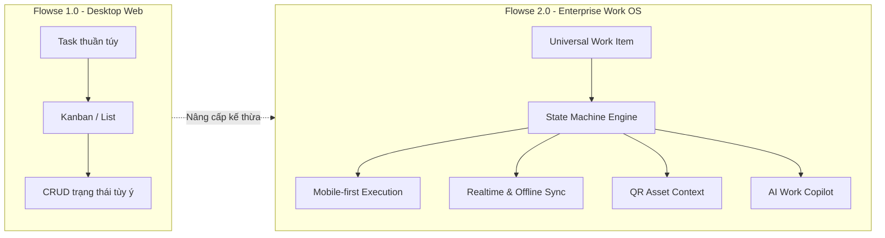

# 🌐 TẦM NHÌN SẢN PHẨM & 6 TRỤ CỘT CỐT LÕI (FLOWSE 2.0)

> **Tài liệu:** Đặt nền móng kiến trúc & định hướng nghiệp vụ  
> **Phiên bản:** Flowse 2.0 — Enterprise Work OS  
> **Thuộc hệ thống:** [Tài liệu đặc tả nghiệp vụ Flowse 2.0](file:///c:/Users/Vinh%20Nguyen/MOBILE/flowse-enterprise-platform/docs/)

---

## 1. TỔNG QUAN & BỐI CẢNH NÂNG CẤP (PARADIGM SHIFT)

### 1.1. Sự chuyển dịch từ Flowse 1.0 lên Flowse 2.0
* **Flowse 1.0 (Web Project Management):** Tập trung vào quản lý công việc văn phòng dạng phẳng (Workspace $\rightarrow$ Space $\rightarrow$ Folder $\rightarrow$ List $\rightarrow$ Task). Hạn chế lớn nhất là chỉ dừng lại ở giao diện Web, mô hình Task-centric thuần túy, thiếu kiểm soát chuyển đổi trạng thái (State Transition), thiếu kết nối với hiện trường nhà xưởng và mất hoàn toàn khả năng làm việc khi mạng ngắt quãng.
* **Flowse 2.0 (Enterprise Work OS):** Tái định nghĩa sản phẩm thành **Hệ điều hành công việc doanh nghiệp theo kiến trúc Mobile-first**. Hệ thống không chỉ quản lý đầu việc mà hợp nhất các nghiệp vụ đa dạng (Sự cố, Đề xuất vật tư, Phê duyệt, Kiểm tra bảo dưỡng) thành một thể thống nhất.

### 1.2. Triết lý vận hành cốt lõi (Core Product Principle)
> **"Web để quản trị và điều phối. Mobile để thực thi công việc. Workflow để điều phối nghiệp vụ."**

* **Khối Hiện trường (Field Operations):** Nhân viên kỹ thuật, công nhân sử dụng **Mobile App** để thao tác nhanh một tay (One-thumb friendly): quét mã QR máy móc, chụp ảnh bằng chứng (evidence), nhận thông báo đẩy tức thời, và thực hiện việc ngay cả khi mất sóng.
* **Khối Văn phòng (Office & Management):** Cấp quản lý sử dụng **Web Management Console** để theo dõi Dashboard tổng quan, giám sát đồng hồ đếm ngược SLA, phân phối công việc (Triage/Assign), và phê duyệt các đề xuất nội bộ.
* **Động cơ Quy trình (Workflow Engine):** Đóng vai trò cầu nối nghiệp vụ, kiểm soát chặt chẽ từng bước chuyển đổi trạng thái, bắt buộc thỏa mãn phân quyền và ghi nhận nhật ký kiểm toán (Audit Trail) không thể xóa sửa.

---

## 2. SÁU TRỤ CỘT NGHIỆP VỤ CỐT LÕI (SIX PILLARS)

Theo bản Đề xuất đề tài (Proposal 1.0), hệ thống hội tụ đủ 6 trụ cột công nghệ và nghiệp vụ:

### 2.1. Trụ cột 1: Trải nghiệm di động thực thi (Mobile-first UX)
* Thiết kế tối ưu cho màn hình cảm ứng, hỗ trợ giao diện tác nghiệp nhanh: **Home (Hôm nay / Quá hạn / Cần duyệt) $\rightarrow$ My Work $\rightarrow$ Scan QR $\rightarrow$ Inbox $\rightarrow$ Profile**.
* Thao tác chính nằm ở tầm với ngón tay cái (Thumb zone), giảm tối đa số bước nhập liệu khi thao tác tại hiện trường bụi bặm hoặc đang mang găng tay bảo hộ.

### 2.2. Trụ cột 2: Đối tượng công việc phổ quát (Universal Work Item)
* Xóa bỏ giới hạn của "Task" thông thường. Mọi đối tượng công việc trong doanh nghiệp đều được trừu tượng hóa thành **Work Item**, kế thừa thuộc tính chung (ID, Tiêu đề, Người tạo, Người xử lý, Trạng thái, SLA, Lịch sử) và mở rộng cho từng loại hình:
  * `TASK`: Việc dự án văn phòng.
  * `REQUEST`: Đề xuất xin cấp thiết bị, vật tư thay thế.
  * `APPROVAL`: Phiếu xét duyệt của cấp quản lý.
  * `INCIDENT`: Báo cáo sự cố máy móc hiện trường.
  * `INSPECTION`: Phiếu kiểm tra bảo dưỡng định kỳ.

### 2.3. Trụ cột 3: Quy trình số hóa & Cam kết dịch vụ (Workflow & Approval Engine)
* Quản lý tiến trình thông qua **Finite State Machine (FSM)**. Không cho phép client gửi status tùy tiện và cập nhật database trực tiếp.
* Tích hợp cam kết thời gian xử lý **SLA (Service Level Agreement)** với cơ chế cảnh báo 3 cấp độ (In SLA $\rightarrow$ At Risk $\rightarrow$ Breached).

### 2.4. Trụ cột 4: Cộng tác thời gian thực (Realtime Collaboration)
* Mọi thay đổi về phân công (Assignment), trạng thái sự cố hoặc bình luận mới đều được phát tán tức thời qua **WebSocket**.
* Cấp quản lý trên Web nhìn thấy sự cố xuất hiện trên màn hình ngay khi công nhân vừa bấm gửi từ Mobile (không cần tải lại trang F5).

### 2.5. Trụ cột 5: Tác nghiệp ngoại tuyến (Offline-first & Delta Sync)
* Đảm bảo tính liên tục của công việc khi di chuyển vào vùng mất sóng (tầng hầm, nhà xưởng bọc tôn, kho sâu).
* Sử dụng bộ nhớ cục bộ SQLite trên thiết bị di động để lưu trữ dữ liệu đã cache và hàng đợi thao tác chờ đồng bộ (`Pending Action Queue`).
* Cơ chế tự động đồng bộ theo lô (Batch Sync), chống tạo trùng dữ liệu bằng `idempotency_key` và phát hiện xung đột dữ liệu phiên bản bằng `base_version` (HTTP 409 Conflict).

### 2.6. Trụ cột 6: Trợ lý trí tuệ nhân tạo (AI Work Copilot)
* AI đóng vai trò **Copilot (Trợ lý đồng hành)**, không phải người ra quyết định thay con người.
* Hỗ trợ tóm tắt chuỗi sự cố phức tạp, truy vấn thông tin theo ngôn ngữ tự nhiên và tạo bản nháp công việc.
* Áp dụng nguyên tắc an toàn: AI chỉ trả về **Action Card (Thẻ hành động)** để người dùng bấm xác nhận; AI tuyệt đối không được tự ý can thiệp cơ sở dữ liệu.

---

## 3. ĐIỂM KẾT NỐI VẬT LÝ VÀ SỐ (QR CONTEXT)

* Mã QR dán trên thân máy móc, cửa phân xưởng hoặc thiết bị đóng vai trò là **Context Resolver (Bộ giải mã ngữ cảnh)**.
* Khi quét mã QR an toàn (Opaque Token), ứng dụng di động ngay lập tức truy xuất toàn bộ thông tin thời gian thực của thiết bị:
  * Trạng thái thiết bị (*Đang chạy / Cảnh báo / Dừng sự cố*).
  * Danh sách sự cố chưa đóng.
  * Phiếu kiểm tra định kỳ đến hạn hôm nay.
  * Nút tác vụ nhanh: **"Báo sự cố tức thì"** (kèm chụp ảnh tại chỗ).

---

## 4. MA TRẬN PHẠM VI MVP ĐỐI VỚI BÀI TẬP LỚN

| Phân hệ / Tính năng | Phạm vi cam kết trong MVP | Đưa vào Roadmap tương lai (Ngoài scope MVP) |
| :--- | :--- | :--- |
| **Work Item Core** | `TASK`, `REQUEST`, `APPROVAL`, `INCIDENT`, `INSPECTION` | Các nghiệp vụ sâu như CMMS tổng thể, bảo trì dự đoán RCM |
| **Workflow** | Chuyển trạng thái FSM, kiểm tra quyền, ghi Audit Trail | Engine kéo thả BPMN 2.0 đầy đủ với Gateway song song |
| **Offline** | SQLite Cache, Pending Queue, Batch Sync, Conflict 409 | Thuật toán CRDT / Vector Clock phân tán phức tạp |
| **Realtime** | WebSocket (Event broadcast) + Push Notification | Cụm Redis Cluster đa vùng, WebRTC video gọi hiện trường |
| **QR Code** | Quét QR mã máy giải mã Context, chụp ảnh evidence | Thẻ từ RFID / NFC công nghiệp, cổng Barrier tự động |
| **AI Copilot** | Tóm tắt sự cố, tạo việc bằng văn bản, Action Card | Tự động phê duyệt ngân sách, tự động ra lệnh máy chạy |
| **Phân quyền** | Workspace RBAC: `Admin`, `Manager`, `Member` kết hợp vai trò hiện trường | Phân quyền ma trận tổ hợp đa công ty (Multi-tenant isolation) |
| **Hệ thống ngoài** | Mock API / Tự chủ dữ liệu nội bộ | Tích hợp sâu vào SAP, Oracle ERP, máy chủ SCADA |
