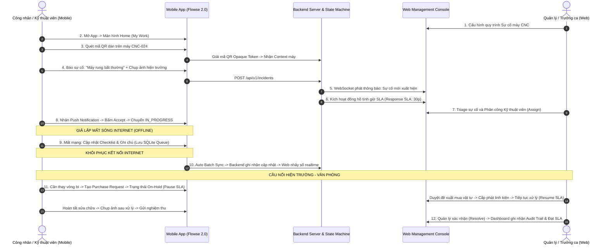

# 🎬 KỊCH BẢN DEMO TỔNG DUYỆT 12 BƯỚC (CANONICAL DEMO FLOW)

> **Mục tiêu:** Kịch bản kịch tính, kết nối thông suốt từ Hiện trường (Mobile) đến Văn phòng (Web), phục vụ báo cáo và bảo vệ đồ án/bài tập lớn.  
> **Căn cứ:** Mục 26 (Trang 16-17) Bản PDF Proposal 1.0 và Chương 16 Bản SRS v1.1.  
> **Thuộc hệ thống:** [Tài liệu đặc tả nghiệp vụ Flowse 2.0](file:///c:/Users/Vinh%20Nguyen/MOBILE/flowse-enterprise-platform/docs/)

---

## 1. SƠ ĐỒ CHUỖI TÁC NGHIỆP TỔNG THỂ

---

## 2. CHI TIẾT 12 BƯỚC DEMO BẢO VỆ ĐỒ ÁN

### Bước 01: Quản lý thiết lập hoặc kiểm tra quy trình trên Web
* **Người thực hiện:** Manager / Admin (trên màn hình Web).
* **Hành động:** Mở trang Cấu hình Quy trình (`Workflow Management`), kiểm tra workflow của loại hình **Incident**:
  * Các trạng thái: `REPORTED` $\rightarrow$ `ASSIGNED` $\rightarrow$ `IN_PROGRESS` $\rightarrow$ `ON_HOLD_PENDING_PARTS` $\rightarrow$ `WAITING_VERIFY` $\rightarrow$ `RESOLVED`.
  * Ràng buộc SLA đi kèm: Mức độ *P2 - High* có thời gian phản hồi là 30 phút, thời gian xử lý là 4 giờ.

### Bước 02: Nhân viên hiện trường mở Mobile App
* **Người thực hiện:** Employee / Worker (trên thiết bị di động).
* **Hành động:** Đăng nhập tài khoản, màn hình **Home** hiển thị giao diện tác nghiệp ưu tiên: số việc quá hạn (`Overdue`), số việc trong ngày (`Today`) và nút nổi bật quét mã QR.

### Bước 03: Quét mã QR định danh máy móc
* **Người thực hiện:** Employee.
* **Hành động:** Hướng camera quét mã QR dán trên thân máy **Máy phay CNC-024**.
* **Phản hồi hệ thống:** Hệ thống giải mã QR Token bảo mật, hiển thị ngay **Digital Context** của máy:
  * Tên máy: *Máy phay CNC 5 trục - Phòng máy A2*.
  * Trạng thái hiện thời: *Hoạt động bình thường*.
  * Lịch sử 3 lần bảo dưỡng gần nhất.
  * Danh mục tác vụ nhanh: Nút **"Báo sự cố tức thì"**.

### Bước 04: Ghi nhận sự cố & Chụp ảnh bằng chứng
* **Người thực hiện:** Employee.
* **Hành động:** Bấm nút "Báo sự cố", nhập nội dung: *"Máy phát tiếng kêu lạ và rung lắc mạnh ở trục xoay"*, chụp 1 tấm ảnh hiện trường làm bằng chứng (Evidence), bấm **Gửi sự cố**.

### Bước 05: Tạo sự cố & Phân loại tự động (Auto-Triage & Realtime Trigger)
* **Người thực hiện:** Hệ thống Backend.
* **Hành động:** 
  * Tạo bản ghi `work_items` loại `INCIDENT` ở trạng thái ban đầu `REPORTED`.
  * Liên kết sự cố với `asset_id` của máy CNC-024.
  * Tự động khởi tạo đồng hồ đo SLA: Bắt đầu tính thời hạn phản hồi.
  * Phát sự kiện WebSocket `INCIDENT_CREATED`.

### Bước 06: Quản lý nhận thông báo tức thời trên Web
* **Người thực hiện:** Manager (quan sát màn hình Web Console).
* **Điểm nhấn thị giác:** Màn hình Web **tự động nhảy thông báo góc phải và xuất hiện thẻ sự cố mới màu đỏ** mà người dùng **không cần bấm F5**.
* Đồng hồ đếm ngược SLA hiển thị thời gian còn lại: `29m:59s...` ở trạng thái màu xanh `IN_SLA`.

### Bước 07: Quản lý phân công kỹ thuật viên (Triage & Assign)
* **Người thực hiện:** Manager.
* **Hành động:** Mở chi tiết sự cố trên Web, xem ảnh bằng chứng công nhân chụp, chọn người xử lý: **Nguyễn Văn Kỹ Thuật (Technician)**, bấm **Chỉ định (Assign)**.
* Trạng thái chuyển thành `ASSIGNED`.

### Bước 08: Kỹ thuật viên tiếp nhận & Chuyển trạng thái xử lý
* **Người thực hiện:** Technician (trên Mobile App).
* **Hành động:** 
  * Mobile rung và phát **Push Notification**: *"Bạn vừa được phân công xử lý Sự cố CNC-024"*.
  * Mở app, bấm nút **Tiếp nhận & Bắt đầu xử lý (Start Work)**.
  * Trạng thái chuyển từ `ASSIGNED` sang `IN_PROGRESS`.

### Bước 09: Giả lập mất kết nối mạng (Tác nghiệp Ngoại tuyến Offline)
* **Người thực hiện:** Người thuyết trình demo.
* **Hành động:** Bật chế độ máy bay (**Airplane Mode**) trên điện thoại.
* **Thao tác:** 
  * Kỹ thuật viên kiểm tra checklist tháo dỡ máy: Đánh dấu hoàn thành các mục kiểm tra.
  * Nhập bình luận tiến độ: *"Đã mở nắp trục, phát hiện vỡ vòng bi đỡ số 3"*.
* **Điểm nhấn kỹ thuật:** Ứng dụng **không bị văng lỗi hay đơ giật**. Màn hình hiển thị nhãn màu cam: **`Chế độ ngoại tuyến • 2 thao tác đang chờ đồng bộ (Pending Sync)`**.

### Bước 10: Khôi phục kết nối mạng & Tự động đồng bộ (Delta Batch Sync)
* **Người thực hiện:** Người thuyết trình demo.
* **Hành động:** Tắt chế độ máy bay (Khôi phục Wifi/4G).
* **Phản hồi hệ thống:** 
  * Trình đồng bộ `Sync Engine` ngầm gom lô các hành động trong SQLite đẩy lên endpoint `/api/v1/sync/batch`.
  * Chống trùng lặp qua `idempotency_key`, kiểm tra `base_version` bảo toàn dữ liệu.
  * Biểu tượng trên điện thoại chuyển sang **`Đã đồng bộ thành công (Synced)`**.
  * Ngay lập tức, trên màn hình Web của Manager, các bình luận và checklist vừa tick ngoại tuyến hiện ra tức thì.

### Bước 11: Cầu nối Hiện trường ↔ Văn phòng (Xin linh kiện & Tạm dừng SLA)
* **Người thực hiện:** Technician (Mobile) & Manager (Web).
* **Hành động:** 
  * Trên Mobile, Kỹ thuật viên bấm nút: **"Yêu cầu cấp phát linh kiện"** $\rightarrow$ Hệ thống tự sinh một `REQUEST` xin mua: *"01 Vòng bi trục chính SKF-6205"*, liên kết trực tiếp với sự cố CNC-024.
  * Sự cố tự động chuyển sang trạng thái: **`ON_HOLD_PENDING_PARTS`**.
  * **Đồng hồ đếm ngược SLA tự động TẠM DỪNG (PAUSED)** để bảo vệ chỉ số KPI cho kỹ thuật viên.
  * Quản lý nhận phiếu duyệt trên tab `Approval Center`, bấm nút **Duyệt cấp phát (Approved)**.
  * Sau khi kho giao linh kiện, Kỹ thuật viên bấm tiếp tục sửa chữa $\rightarrow$ Trạng thái trở lại `IN_PROGRESS` $\rightarrow$ **SLA tự động tiếp tục đếm ngược (Resumed)**.

### Bước 12: Hoàn tất, Trợ lý AI tóm tắt & Nghiệm thu trên Dashboard
* **Người thực hiện:** Technician & Manager & AI Copilot.
* **Hành động:** 
  * Kỹ thuật viên chụp ảnh vòng bi mới đã lắp, bấm **Gửi nghiệm thu (Submit for Verification)** $\rightarrow$ Chuyển trạng thái `WAITING_VERIFY`.
  * Trợ lý **AI Copilot** tự động tổng hợp tóm tắt chuỗi sự cố: *"Sự cố rung máy CNC-024 phát sinh lúc 10h15, nguyên nhân vỡ vòng bi SKF, đã được thay mới và kiểm tra an toàn lúc 11h30"*.
  * Quản lý trên Web xem tóm tắt của AI, kiểm tra ảnh chụp nghiệm thu, bấm nút **Đóng sự cố (Resolve)**.
  * Mở trang **Dashboard & Audit Trail**: Hiển thị toàn bộ nhật ký lịch sử từng giây, thời gian xử lý thực tế đạt chuẩn SLA, điểm tin cậy đạt 100%.

---

## 3. THÔNG ĐIỆP BẢO VỆ ĐỒ ÁN CHỐT LẠI TỪ KỊCH BẢN
1. **Không phải CRUD đơn giản:** Mọi hành vi đều đi qua máy trạng thái FSM chặt chẽ có kiểm tra quyền và tự động hóa.
2. **Thuyết phục về mặt thực tế:** Giải quyết đúng nỗi đau doanh nghiệp sản xuất — kết nối trơn tru giữa người cầm búa dưới xưởng và người quản trị ngồi văn phòng.
3. **Kỹ thuật phần mềm vững chắc:** Xử lý tinh tế vấn đề mất mạng tại nhà máy bằng cơ chế Offline-first chuẩn mực.
