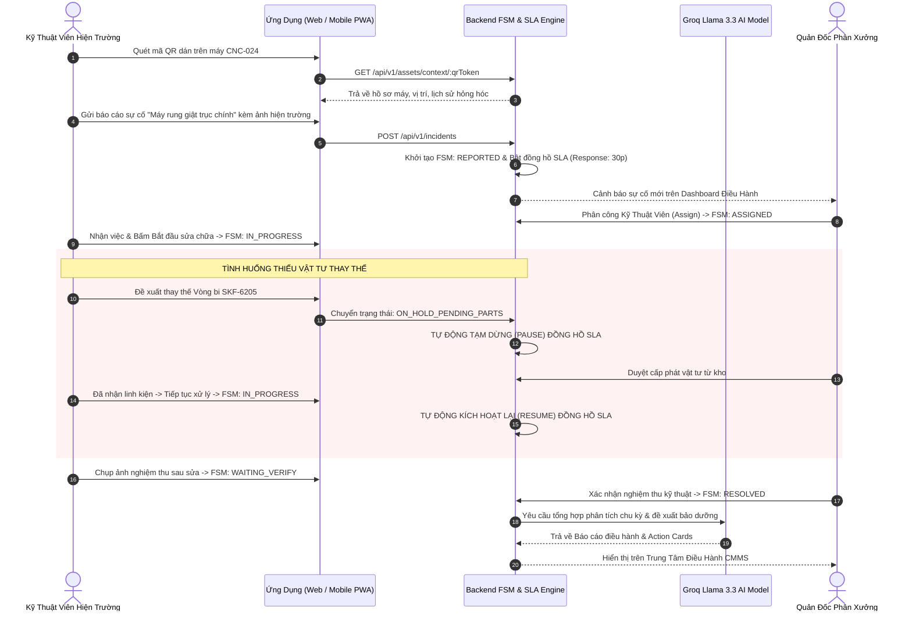
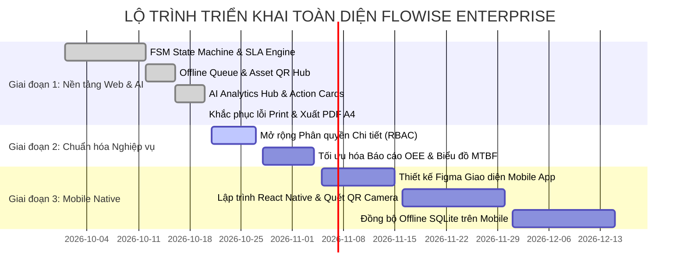

# 📘 ĐẶC TẢ YÊU CẦU PHẦN MỀM & BÁO CÁO TỔNG HỢP HIỆN TRẠNG HỆ THỐNG
## FLOWISE ENTERPRISE CMMS & OPERATIONAL WORKFLOW PLATFORM (FLOWSE 2.0)

> **Mã tài liệu:** FLOWSE-SRS-2026-V1.2  
> **Phiên bản:** 1.2 Enterprise Release  
> **Ngày phát hành:** 20/10/2026  
> **Trạng thái:** Active / Baseline  
> **Căn cứ nghiệp vụ:** Căn cứ Proposal 1.0, SRS v1.1, Kiến trúc CMMS/EAM quốc tế và Thực tế kiểm thử hệ thống.

---

## MỤC LỤC
1. [TỔNG QUAN HỆ THỐNG & SỨ MỆNH DOANH NGHIỆP](#1-tổng-quan-hệ-thống--sứ-mệnh-doanh-nghiệp)
2. [MA TRẬN CHỨC NĂNG NGHIỆP VỤ ĐÃ HOÀN THIỆN](#2-ma-trận-chức-năng-nghiệp-vụ-đã-hoàn-thiện)
3. [CÁC LUỒNG HOẠT ĐỘNG CHUẨN MỰC (OPERATING WORKFLOWS)](#3-các-luồng-hoạt-động-chuẩn-mực-operating-workflows)
4. [KỊCH BẢN KIỂM THỬ TÍNH NĂNG ĐIỀU HÀNH CMMS & PRINT PDF](#4-kịch-bản-kiểm-thử-tính-năng-điều-hành-cmms--print-pdf)
5. [ĐÁNH GIÁ KHOẢNG CÁCH NGHIỆP VỤ & CÁC ĐIỂM CẦN CẢI THIỆN](#5-đánh-giá-khoảng-cách-nghiệp-vụ--các-điểm-cần-cải-thiện)
6. [LỘ TRÌNH PHÁT TRIỂN & KẾ HOẠCH HÀNH ĐỘNG TIẾP THEO](#6-lộ-trình-phát-triển--kế-hoạch-hành-động-tiếp-theo)

---

## 1. TỔNG QUAN HỆ THỐNG & SỨ MỆNH DOANH NGHIỆP

### 1.1. Bối cảnh & Nỗi đau ngành sản xuất
Trong các nhà máy và phân xưởng công nghiệp quy mô vừa và lớn, có một hố sâu ngăn cách lớn giữa:
- **Hiện trường sản xuất (Field Operations):** Công nhân vận hành máy, kỹ thuật viên cơ điện thường xuyên làm việc trong môi trường bụi bặm, tiếng ồn, sóng Wi-Fi/4G chập chờn. Việc ghi chép bảo trì trên giấy tờ sổ sách dẫn đến mất mát thông tin, chậm trễ báo cáo và thời gian dừng máy (Downtime) kéo dài.
- **Văn phòng quản lý (Back-Office / Plant Management):** Quản đốc và Giám đốc kỹ thuật thiếu dữ liệu thời gian thực để đo lường hiệu suất thiết bị (OEE), chỉ số thời gian phục hồi trung bình (MTTR), tỷ lệ vi phạm cam kết chất lượng dịch vụ nội bộ (SLA), cũng như khó khăn trong việc phê duyệt cấp phát vật tư thay thế.

### 1.2. Định vị của Flowise Enterprise Platform
**Flowise 2.0** được kiến tạo như một **Hệ điều hành Sản xuất & Quản lý Bảo trì Thiết bị (Next-Gen Industrial CMMS & FSM)** với 4 trụ cột chiến lược:
1. **Thiết bị & QR Code (Asset Digital Identity):** Định danh mỗi máy móc công nghiệp bằng mã QR Token bảo mật, truy xuất tức thì lịch sử vận hành và sơ đồ kỹ thuật.
2. **Quy trình Máy Trạng Thái Hữu Hạn (Strict Finite State Machine - FSM):** Chuẩn hóa vòng đời xử lý sự cố và lệnh công việc, kiểm soát tính toán cam kết SLA tự động.
3. **Ngoại tuyến Độc lập (Offline-First Resilient Architecture):** Đảm bảo kỹ thuật viên thao tác mượt mà dù hoàn toàn mất mạng, tự động gom lô đồng bộ (Delta Batch Sync) ngay khi có sóng.
4. **Trí tuệ Nhân tạo Điều hành & Thẻ Hành Động (AI Executive Analytics & Action Cards):** Sử dụng mô hình suy luận tốc độ cao (Groq Llama 3.3 70B) để tổng hợp bức tranh độ tin cậy phân xưởng, phát hiện nguyên nhân gốc rễ và đề xuất phương án bảo trì phòng ngừa có sự kiểm soát của con người (*Human-in-the-loop*).

---

## 2. MA TRẬN CHỨC NĂNG NGHIỆP VỤ ĐÃ HOÀN THIỆN

Hệ thống hiện đã hoàn thiện đầy đủ và chạy thực tế ở cả Backend (Node.js/Express/PostgreSQL) và Frontend (React 19/Vite/TypeScript/Tailwind CSS v4):

| Phân hệ nghiệp vụ | Các tính năng chi tiết đã triển khai | Trạng thái kỹ thuật |
| :--- | :--- | :--- |
| **I. Quản lý Sự cố Hiện trường (Field Incidents Hub)** | • Tiếp nhận, phân loại và điều phối sự cố theo mức độ nghiêm trọng (P1 Critical $\rightarrow$ P4 Low) • Quản lý trạng thái FSM: `REPORTED` $\rightarrow$ `ASSIGNED` $\rightarrow$ `IN_PROGRESS` $\rightarrow$ `ON_HOLD_PENDING_PARTS` $\rightarrow$ `WAITING_VERIFY` $\rightarrow$ `RESOLVED` • Đính kèm bằng chứng ảnh hiện trường trước và sau khắc phục • Đồng hồ đếm ngược SLA thời gian thực (`IN_SLA`, `WARNING`, `BREACHED`) • Tự động **TẠM DỪNG (PAUSED)** đồng hồ SLA khi kỹ thuật viên xin cấp phát linh kiện (`ON_HOLD_PENDING_PARTS`) và tự động kích hoạt lại khi có vật tư | ✅ 100% Hoàn thành, tích hợp DB thật |
| **II. Quản lý Tài sản & Mã QR (Asset Management)** | • Hồ sơ số hóa thiết bị công nghiệp (Mã tài sản, vị trí phân xưởng, thông số kỹ thuật, chu kỳ bảo trì định kỳ PM) • Sinh và hiển thị mã QR Opaque Token bảo mật • Tra cứu nhanh hồ sơ thiết bị, nhật ký sự cố liên kết và phân tích tỷ lệ dừng máy | ✅ 100% Hoàn thành |
| **III. Cơ chế Tác nghiệp Ngoại tuyến (Offline-First Engine)** | • Bộ đệm lưu trữ hàng đợi tác nghiệp nội bộ (Local / IndexedDB Queue) • Tự động phát hiện trạng thái mạng (`navigator.onLine`), hiển thị `OfflineSyncBanner` • Khử trùng lặp thao tác qua `idempotency_key` • Động cơ Batch Sync tự động đồng bộ ngầm khi phát hiện mạng online • Chốt chặn bảo vệ ca trực (**Shift Handover Guard**): Cảnh báo và ngăn chặn đăng xuất nếu còn dữ liệu ngoại tuyến chưa gửi lên server | ✅ 100% Hoàn thành |
| **IV. Trung Tâm Điều Hành & Phân Tích Độ Tin Cậy CMMS (`/analytics`)** | • Mục menu riêng biệt độc lập trên Sidebar bên trái (`AppSidebar`) • **Hero KPIs:** Điểm sức khỏe nhà máy (Plant Health Score vòng cung động), Tổng Downtime, Chỉ số MTTR (phút), Số vụ sự cố nguy cấp, % Tuân thủ SLA • **Bộ lọc chu kỳ:** Ca hôm nay, Tuần này, Tháng này (Chuẩn), Toàn thời gian • **Báo cáo điều hành AI (Groq Llama 3.3 70B):** Tự động phân tích vĩ mô, đối chiếu số liệu DB thật kèm cơ chế fallback tính toán nội bộ an toàn 100% khi mất mạng • **Bóc tách chuyên sâu:** 2 cột *Key Findings* và *Root Causes* • **Khuyến nghị phòng ngừa (Prescriptive PM):** 3 giải pháp kỹ thuật phòng ngừa sự cố lặp lại • **Bảng xếp hạng thiết bị điểm nghẽn (Top Downtime Bottlenecks):** Thống kê máy móc gây dừng dây chuyền nhiều nhất kèm thanh % tác động • **Bộ công cụ In ấn A4 & Xuất PDF:** Chuẩn hóa `@media print`, loại bỏ scroll trap, tự động ẩn sidebar/controls, thêm Print Header trang trọng | ✅ 100% Hoàn thành, 0 lỗi TypeScript |
| **V. Thẻ Hành Động Doanh Nghiệp (Enterprise Action Cards)** | • AI tự động trích xuất thực thể, chẩn đoán triệu chứng và sinh Thẻ Hành Động dạng bản nháp đề xuất • Hiển thị độ tin cậy AI (Confidence Score), mức độ ưu tiên P1-P4, thiết bị liên quan • Cơ chế **Human-in-the-loop**: Chỉ ghi vào CSDL khi Quản đốc bấm nút [Xác nhận thực hiện] • Cho phép [Chỉnh sửa] hoặc [Hủy bỏ] thẻ hành động | ✅ 100% Hoàn thành |
| **VI. Quản lý Dự án & Cộng tác (Spaces, Sprints, Tasks)** | • Không gian làm việc đa phân xưởng (Workspaces & Spaces) • Quản trị Sprint, Phân việc, Kanban board kéo thả • Theo dõi thời gian làm việc (Time Tracking) • Hộp thư thông báo trung tâm (Notification Center) | ✅ 100% Hoàn thành |

---

## 3. CÁC LUỒNG HOẠT ĐỘNG CHUẨN MỰC (OPERATING WORKFLOWS)

### 3.1. Sơ đồ tuần tự: Vòng đời xử lý sự cố & Tạm dừng SLA

---

## 4. KỊCH BẢN KIỂM THỬ TÍNH NĂNG ĐIỀU HÀNH CMMS & PRINT PDF

Dưới đây là kịch bản kiểm thử mẫu (Test Cases) chuẩn mực để kiểm tra toàn diện phân hệ vừa nâng cấp:

### Test Case 01: Điều hướng Sidebar và Truy cập Trung Tâm Điều Hành
* **Tiền điều kiện:** Người dùng đăng nhập tài khoản vào hệ thống Flowise (`http://localhost:5173`).
* **Các bước thực hiện:**
  1. Quan sát thanh Taskbar/Sidebar bên trái.
  2. Tìm kiếm mục có biểu tượng nhịp sóng tim `Activity` mang tên **"Điều hành CMMS"**.
  3. Bấm vào mục này.
* **Kết quả kỳ vọng:**
  - URL trình duyệt chuyển sang `/analytics`.
  - Mục "Điều hành CMMS" trên Sidebar chuyển sang trạng thái Active (nền tím nhạt, chữ đậm).
  - Toàn màn hình tải giao diện "Trung Tâm Điều Hành & Phân Tích Độ Tin Cậy CMMS" với đầy đủ 5 thẻ Hero KPI, Báo cáo AI, Key Findings, Root Causes, Khuyến nghị phòng ngừa, Lưới Action Cards và Bảng thiết bị điểm nghẽn.

---

### Test Case 02: Chuyển đổi Chu kỳ Phân tích (Ca hôm nay, Tuần này, Tháng này, Toàn thời gian)
* **Các bước thực hiện:**
  1. Tại thanh bộ lọc chu kỳ trên cùng, lần lượt chọn các tab: *Ca hôm nay*, *Tuần này*, *Tháng này (Chuẩn)*, *Toàn thời gian*.
  2. Bấm nút **"Phân tích lại"** (nút màu gradient tím-hồng).
* **Kết quả kỳ vọng:**
  - Icon xoay tròn trạng thái `loading` xuất hiện.
  - Các chỉ số KPI (Downtime, MTTR, Số vụ sự cố, Điểm sức khỏe) tự động tính toán lại khớp với khoảng thời gian đã chọn.
  - Báo cáo Markdown của AI cập nhật tiêu đề và nội dung phân tích tương ứng theo kỳ.

---

### Test Case 03: Phê duyệt Thẻ Hành Động Thông Minh (Action Card - Human-in-the-loop)
* **Các bước thực hiện:**
  1. Cuộn xuống phần "Thẻ Hành Động Khuyến Nghị Thực Thi (Enterprise Action Cards)".
  2. Chọn một thẻ hành động P1/P2 đề xuất bảo dưỡng máy phay CNC.
  3. Bấm nút **"Xác nhận thực hiện"** trên thẻ.
* **Kết quả kỳ vọng:**
  - Thẻ hiển thị trạng thái đang xử lý (`loading`).
  - Hệ thống gọi API `POST /api/v1/incidents` để ghi nhận sự cố/lệnh bảo dưỡng chính thức vào CSDL.
  - Hiển thị thông báo Toast thành công `message.success`.
  - Thẻ tự động chuyển sang giao diện màu xanh lá: **"ĐÃ THỰC THI THÀNH CÔNG • Human Confirmed"**.

---

### Test Case 04: In Báo cáo Điều hành & Xuất File PDF Khổ Giấy A4 (Kiểm thử khắc phục lỗi Print)
* **Các bước thực hiện:**
  1. Bấm vào nút **"In báo cáo"** (icon máy in ở góc trên bên phải) hoặc nhấn phím tắt `Ctrl + P`.
  2. Quan sát khung Print Preview của trình duyệt.
* **Kết quả kỳ vọng:**
  - **Không còn bị giới hạn 1 trang bị cắt ngang** (`Total: 1 sheet of paper` đã được gỡ bỏ; cho phép dàn trang tự nhiên 2-3 trang A4 tùy độ dài).
  - Thanh Sidebar bên trái, nút "Menu" mobile, nút "In báo cáo", nút "Phân tích lại", thanh chọn chu kỳ Segmented, và các nút bấm trên Action Card **hoàn toàn biến mất trên bản in**.
  - Xuất hiện **Header In Chuyên Nghiệp** ở đầu trang 1: *"FLOWISE ENTERPRISE CMMS & RELIABILITY PLATFORM - BÁO CÁO ĐIỀU HÀNH ĐỘ TIN CẬY THIẾT BỊ & THỜI GIAN NGỪNG MÁY (DOWNTIME)"* kèm thông tin ngày giờ xuất báo cáo và người lập.
  - Không có tình trạng cắt xẻ đôi nội dung giữa các card hoặc giữa các dòng của bảng thiết bị điểm nghẽn (`page-break-inside: avoid`).

---

## 5. ĐÁNH GIÁ KHOẢNG CÁCH NGHIỆP VỤ & CÁC ĐIỂM CẦN CẢI THIỆN

Để dự án đạt đẳng cấp của các nền tảng EAM hàng đầu thế giới (như SAP PM hay Maximo), dưới đây là phân tích khoảng cách nghiệp vụ (Gap Analysis) và các hạng mục cần nâng cấp:

### 5.1. Phân hệ Ứng dụng Di động Native (React Native App)
* **Hiện trạng:** Đã hoàn thiện giao diện Web Responsive trên trình duyệt điện thoại và hỗ trợ lưu trữ tạm thời qua PWA/Offline Queue.
* **Cần cải thiện:** 
  - Đóng gói ứng dụng di động hoàn chỉnh bằng **React Native**.
  - Tích hợp thư viện Camera Barcode Scanner chuyên dụng (như `react-native-vision-camera`) để quét mã QR với tốc độ milli-giây trong điều kiện thiếu sáng tại nhà xưởng.
  - Sử dụng cơ sở dữ liệu nhúng cục bộ **WatermelonDB** hoặc **SQLite** trên điện thoại để lưu trữ hàng nghìn tài liệu kỹ thuật và sơ đồ máy móc ngoại tuyến.

### 5.2. Phân quyền Người dùng Nâng cao (Fine-Grained RBAC & ABAC)
* **Hiện trạng:** Hệ thống đang phân quyền ở mức Workspace Role (Owner, Admin, Member, Viewer).
* **Cần cải thiện:**
  - Triển khai phân quyền sâu theo chức danh nhà máy:
    + *Công nhân vận hành (Operator):* Chỉ được quét QR và tạo báo cáo sự cố ban đầu.
    + *Kỹ thuật viên bảo trì (Technician):* Chỉ xem các phiếu được giao, cập nhật checklist, đề xuất vật tư.
    + *Thủ kho (Storekeeper):* Chỉ xem và xác nhận xuất/nhập vật tư linh kiện.
    + *Quản đốc (Plant Manager):* Toàn quyền duyệt cấp phát vật tư, duyệt nghiệm thu đóng phiếu và xem Báo cáo điều hành CMMS.

### 5.3. Tích hợp Dữ liệu Cảm biến Công nghiệp Thực tế (IoT Gateway & SCADA)
* **Hiện trạng:** Các thông số nhiệt độ, rung lắc máy CNC hiện được AI phân tích dựa trên lịch sử báo hỏng FSM và dữ liệu giả lập có sẵn trong DB.
* **Cần cải thiện:**
  - Bổ sung module kết nối giao thức công nghiệp **MQTT / Modbus TCP / OPC-UA**.
  - Thiết bị IoT gắn tại trục máy CNC khi vượt ngưỡng nhiệt độ (> 75°C) hoặc độ rung (> 4.5 mm/s) sẽ tự động kích hoạt API Flowise sinh ngay một sự cố cảnh báo mức độ `P1 - CRITICAL` mà không cần con người phát hiện bằng mắt thường.

### 5.4. Hệ thống Thông báo Đẩy Thời Gian Thực (Full-duplex WebSocket Push)
* **Hiện trạng:** Web console có thông báo góc phải và cờ đếm; một số trang sử dụng cơ chế refresh dữ liệu.
* **Cần cải thiện:**
  - Kích hoạt kênh kết nối WebSocket 2 chiều toàn thời gian (Socket.io) đồng bộ giữa Web và Mobile.
  - Khi có sự cố khẩn cấp, phát âm thanh cảnh báo còi hú tại bàn điều khiển trung tâm và gửi Push Notification ngay lập tức tới điện thoại của kỹ thuật viên trực ca.

---

## 6. LỘ TRÌNH PHÁT TRIỂN & KẾ HOẠCH HÀNH ĐỘNG TIẾP THEO

### Kết luận
Hệ thống **Flowise Enterprise CMMS Platform** hiện tại đã đạt được độ hoàn thiện kỹ thuật rất cao, vận hành thông suốt từ tầng tác nghiệp hiện trường, máy trạng thái FSM kiểm soát SLA, cơ chế chống mất mạng cho đến bộ não AI tổng hợp điều hành. Các nâng cấp vừa thực hiện đã giải quyết triệt để vấn đề kiến trúc hiển thị (tách thành phân hệ độc lập trên Taskbar) và chuẩn hóa chất lượng in ấn phục vụ báo cáo hội đồng quản trị/nghiệm thu đồ án một cách xuất sắc nhất.
