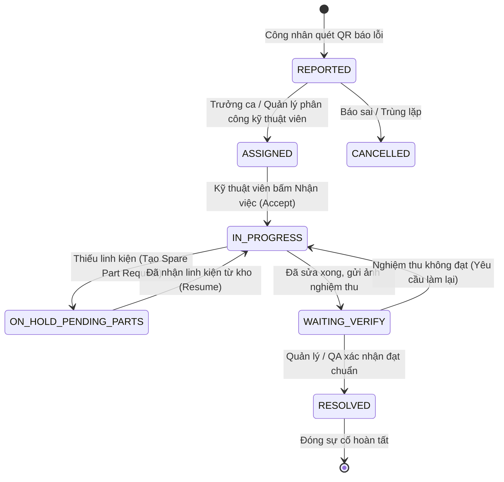
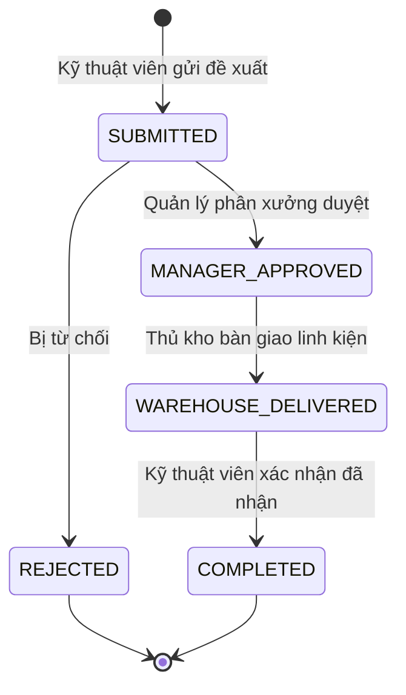

# ⚙️ ĐỘNG CƠ QUY TRÌNH & MÁY TRẠNG THÁI (WORKFLOW STATE MACHINE)

> **Phân hệ:** Động cơ điều phối nghiệp vụ cốt lõi (Workflow Engine)  
> **Áp dụng cho:** Tất cả các loại Work Item  
> **Thuộc hệ thống:** [Tài liệu đặc tả nghiệp vụ Flowse 2.0](file:///c:/Users/Vinh%20Nguyen/MOBILE/flowse-enterprise-platform/docs/)

---

## 1. NGUYÊN TẮC BẢO TOÀN TRẠNG THÁI (CORE PRINCIPLES)

1. **Nghiêm cấm Client tự ý đổi Status:** Client (Web/Mobile) không được phép gửi chuỗi `status` tùy ý qua các API cập nhật thông thường kiểu `UPDATE work_items SET status = 'DONE'`. Mọi sự thay đổi trạng thái bắt buộc phải thông qua endpoint:
   `POST /api/v1/workflows/items/:itemId/transition`
2. **Kiểm tra 5 điều kiện tiên quyết:** Để một bước chuyển trạng thái (Transition) được chấp thuận, Backend phải xác thực trong cùng một Database Transaction:
   * **Điều kiện 1:** Trạng thái hiện tại của item phải trùng khớp với `from_state` của bước chuyển.
   * **Điều kiện 2:** Người thực hiện (Actor) phải có vai trò phù hợp nằm trong danh sách `allowed_roles`.
   * **Điều kiện 3:** Nếu có quy định người nhận việc, Actor phải là người được phân công (`assignee_id = current_user.id`) hoặc là Quản lý (`Manager/Admin`).
   * **Điều kiện 4:** Các trường dữ liệu bắt buộc đi kèm (`required_fields`) phải được cung cấp đầy đủ (Ví dụ: Chuyển sang `RESOLVED` bắt buộc phải có ảnh nghiệm thu `resolved_evidence_url`).
   * **Điều kiện 5:** Số phiên bản (`version`) gửi lên phải khớp với `version` hiện hành trong DB (Optimistic Locking).
3. **Lưu vết tự động (Automatic Audit Trail):** Mỗi lần bước chuyển thành công, hệ thống tự động ghi một dòng lịch sử vào bảng `activity_logs` và tăng `version = version + 1`.

---

## 2. MA TRẬN QUY TRÌNH SỰ CỐ HIỆN TRƯỜNG (INCIDENT WORKFLOW)

Đây là quy trình trọng tâm phục vụ khối vận hành nhà xưởng:



### Bảng chi tiết các bước chuyển (Transition Matrix)

| ID | Trạng thái nguồn (`from`) | Trạng thái đích (`to`) | Tên hành động hiển thị | Ai được quyền (`allowed_roles`) | Dữ liệu bắt buộc (`required_fields`) | Tác vụ tự động đi kèm (Side Effects) |
| :--- | :--- | :--- | :--- | :--- | :--- | :--- |
| **TR-01** | `REPORTED` | `ASSIGNED` | Phân công xử lý | `Manager`, `Admin` | `assignee_id` | Gửi Push Notification tới Kỹ thuật viên; Dừng đồng hồ Response SLA. |
| **TR-02** | `REPORTED` | `CANCELLED` | Hủy sự cố | `Manager`, `Admin` | `cancellation_reason` | Dừng toàn bộ SLA; Ghi audit log lý do hủy. |
| **TR-03** | `ASSIGNED` | `IN_PROGRESS` | Tiếp nhận & Bắt đầu | `Assignee` (Kỹ thuật viên) | *(Không bắt buộc)* | Bắt đầu tính giờ Resolve SLA thực tế; Bắn WebSocket cập nhật Web. |
| **TR-04** | `IN_PROGRESS` | `ON_HOLD_PENDING_PARTS` | Tạm dừng chờ linh kiện | `Assignee`, `Manager` | `spare_part_name`, `quantity` | **Tạm dừng đồng hồ tính giờ SLA (PAUSED)**; Tự động sinh `REQUEST` xin vật tư. |
| **TR-05** | `ON_HOLD_PENDING_PARTS` | `IN_PROGRESS` | Đã có linh kiện, làm tiếp | `Assignee`, `Manager` | *(Không bắt buộc)* | **Kích hoạt lại đồng hồ SLA (RESUMED)**. |
| **TR-06** | `IN_PROGRESS` | `WAITING_VERIFY` | Gửi nghiệm thu | `Assignee` | `resolution_summary`, `evidence_url` | Chuyển quyền thao tác sang Quản lý / QA; Gửi thông báo cần nghiệm thu. |
| **TR-07** | `WAITING_VERIFY` | `IN_PROGRESS` | Trả lại (Nghiệm thu trượt) | `Manager`, `Admin` | `reject_reason` | Trừ điểm đánh giá chất lượng; Thông báo cho Kỹ thuật viên sửa lại. |
| **TR-08** | `WAITING_VERIFY` | `RESOLVED` | Đóng sự cố thành công | `Manager`, `Admin` | *(Không bắt buộc)* | Dừng vĩnh viễn SLA; Đánh dấu máy móc đã an toàn; Ghi nhận hoàn tất. |

---

## 3. MA TRẬN QUY TRÌNH XIN CẤP LINH KIỆN & VẬT TƯ (PURCHASE REQUEST WORKFLOW)

Quy trình kết nối trực tiếp với Trung tâm phê duyệt (Approval Center):



### Bảng chi tiết bước chuyển Đề xuất

| Trạng thái nguồn | Trạng thái đích | Hành động | Vai trò cho phép | Tác vụ tự động kích hoạt |
| :--- | :--- | :--- | :--- | :--- |
| `SUBMITTED` | `MANAGER_APPROVED` | Phê duyệt đề xuất | `Manager`, `Admin` | Tự động sinh phiếu xuất kho; Thông báo cho Bộ phận kho vật tư. |
| `SUBMITTED` | `REJECTED` | Từ chối đề xuất | `Manager`, `Admin` | Bắt buộc nhập lý do từ chối; Thông báo cho người đề xuất. |
| `MANAGER_APPROVED` | `WAREHOUSE_DELIVERED` | Xuất kho giao hàng | `Manager`, `Thủ kho` | Gửi thông báo đến Kỹ thuật viên xuống kho nhận đồ. |
| `WAREHOUSE_DELIVERED` | `COMPLETED` | Xác nhận đã nhận đồ | `Người đề xuất` | **Tự động chuyển Incident liên quan từ `ON_HOLD` sang `IN_PROGRESS`**. |

---

## 4. MA TRẬN QUY TRÌNH CÔNG VIỆC DỰ ÁN VĂN PHÒNG (STANDARD TASK WORKFLOW)

Kế thừa trực tiếp từ Flowse 1.0 nhằm đảm bảo các bảng Kanban Board hoạt động mượt mà:

```text
    ┌────────┐      ┌─────────────┐      ┌──────────┐      ┌────────┐
    │  TODO  │ ───> │ IN_PROGRESS │ ───> │  REVIEW  │ ───> │  DONE  │
    └────────┘      └─────────────┘      └──────────┘      └────────┘
        ▲                                     │
        └─────────────────────────────────────┘ (Bị từ chối làm lại)
```

* `TODO` $\rightarrow$ `IN_PROGRESS`: Bất kỳ thành viên nào được phân công đều có thể thực hiện.
* `IN_PROGRESS` $\rightarrow$ `REVIEW`: Người thực hiện nộp kết quả kèm tệp đính kèm.
* `REVIEW` $\rightarrow$ `DONE`: Người giao việc (Creator) hoặc Quản lý dự án bấm duyệt hoàn thành.
* `REVIEW` $\rightarrow$ `IN_PROGRESS`: Quản lý yêu cầu chỉnh sửa lại.

---

## 5. CƠ CHẾ TỰ ĐỘNG HÓA KHI CHUYỂN TRẠNG THÁI (AUTOMATION HOOKS)

Workflow Engine được thiết kế với cơ chế Hook kiến trúc Pub/Sub:
1. **Trước khi Commit (Pre-transition Validation):**
   * Kiểm tra điều kiện logic nghiệp vụ (ví dụ: Không thể nghiệm thu nếu chưa upload ảnh hiện trường).
2. **Trong lúc Commit (Transactional DB Write):**
   * Cập nhật `status`, `updated_at`, `version = version + 1`.
   * Ghi bản ghi `activity_logs` chứa `actor_id`, `from_status`, `to_status`, `metadata`.
3. **Sau khi Commit (Post-transition Events):**
   * Phát sự kiện WebSocket ra ngoài Redis / Socket.IO.
   * Gửi thông báo đẩy Firebase Cloud Messaging (FCM) đến điện thoại của người liên quan.
   * Kích hoạt hoặc tạm dừng Worker đồng hồ đếm ngược SLA.
