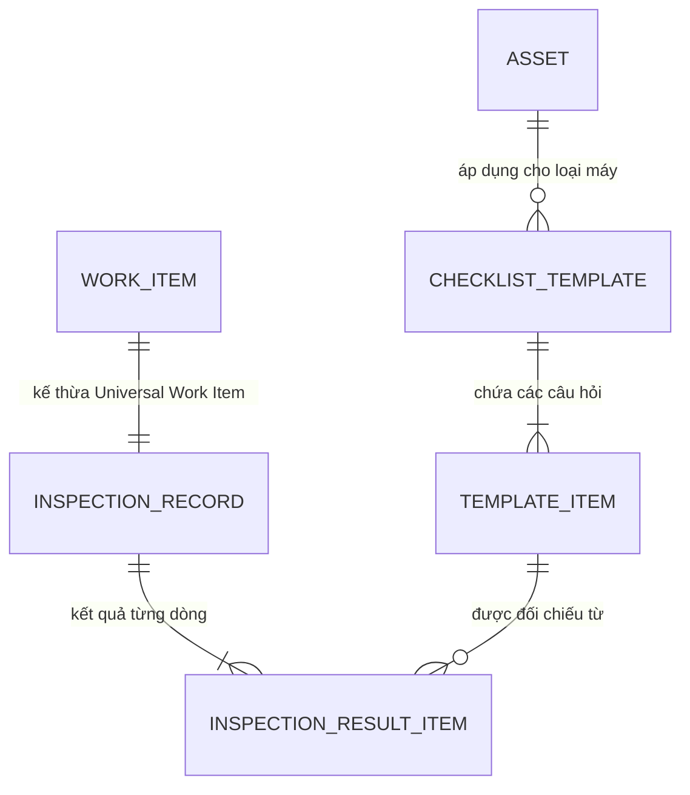

# 📋 ĐỘNG CƠ KIỂM TRA BẢO DƯỠNG ĐỊNH KỲ (INSPECTION CHECKLIST)

> **Phân hệ:** Tác nghiệp hiện trường (Field Operations) & Kiểm soát chất lượng (QA)  
> **Áp dụng cho:** Kỹ thuật viên bảo trì, Nhân viên kiểm định chất lượng (QA), Trưởng ca  
> **Thuộc hệ thống:** [Tài liệu đặc tả nghiệp vụ Flowse 2.0](file:///c:/Users/Vinh%20Nguyen/MOBILE/flowse-enterprise-platform/docs/)

---

## 1. MỤC TIÊU & Ý NGHĨA NGHIỆP VỤ

Trong sản xuất công nghiệp, kiểm tra định kỳ (Preventive Inspection) là chìa khóa để ngăn ngừa dừng máy đột ngột. Nếu chỉ chờ máy hỏng mới đi sửa (Reactive), thiệt hại về năng suất là rất lớn.

**Phân hệ Inspection Checklist của Flowse 2.0** cho phép:
* Ban hành các **Mẫu kiểm tra tiêu chuẩn (Checklist Templates)** theo từng dòng máy hoặc khu vực.
* Nhân viên kỹ thuật cầm điện thoại đi kiểm tra từng hạng mục, tick Pass/Fail hoặc nhập chỉ số kỹ thuật thực tế.
* **Tự động kích hoạt Sự cố (Auto-generate Incident):** Nếu bất kỳ hạng mục nào bị đánh giá là không đạt (`FAIL`) hoặc chỉ số kỹ thuật vượt ngưỡng nguy hiểm, hệ thống tự động sinh ra một `INCIDENT` gắn liền với máy đó để kịp thời can thiệp.

---

## 2. KIẾN TRÚC MÔ HÌNH DỮ LIỆU CHECKLIST

Hệ thống tách biệt rõ ràng giữa **Định nghĩa mẫu kiểm tra** và **Lần thực hiện kiểm tra cụ thể**:



1. **`checklist_templates` (Mẫu kiểm tra):**
   * Ví dụ: *"Quy trình kiểm tra an toàn đầu ca cho Máy phay CNC"*.
   * Thuộc tính: `id`, `name`, `asset_type`, `frequency` (Hàng ngày, Hàng tuần, Hàng tháng).
2. **`template_items` (Các dòng tiêu chí kiểm tra trong mẫu):**
   * Định nghĩa câu hỏi kiểm tra, kiểu dữ liệu, ngưỡng quy chuẩn.
3. **`inspection_records` (Phiếu kiểm tra thực tế gắn với Work Item):**
   * Thực hiện tại hiện trường: ai làm, máy nào, thời gian bắt đầu/kết thúc, tổng điểm đạt/hỏng.
4. **`inspection_result_items` (Kết quả chi tiết từng tiêu chí):**
   * Giá trị thực tế ghi nhận, trạng thái đạt hay hỏng, ảnh chụp làm chứng.

---

## 3. CÁC ĐỊNH DẠNG HẠNG MỤC KIỂM TRA (ITEM TYPES)

| Loại dữ liệu | Tên gọi | Cách thức nhập liệu trên Mobile | Tiêu chí đánh giá Đạt / Không đạt | Yêu cầu bằng chứng |
| :--- | :--- | :--- | :--- | :--- |
| **`BOOLEAN`** | Đúng / Sai | 2 nút bấm lớn: **[ PASS ]** (Màu xanh) và **[ FAIL ]** (Màu đỏ). | Bấm `PASS` là Đạt, bấm `FAIL` là Hỏng. | **Bắt buộc chụp ảnh** nếu chọn `FAIL`. |
| **`NUMERIC`** | Chỉ số đo đạc | Bàn phím số nhập giá trị thực tế (vd: Nhiệt độ dầu, Áp suất khí nén, Độ rung). | So khớp tự động với dải quy chuẩn `[min_value, max_value]`. | Chụp ảnh đồng hồ đo nếu chỉ số vượt ngưỡng. |
| **`CHOICE`** | Chọn một phương án | Danh sách thả xuống hoặc Radio button (vd: Mức dầu: Đầy / Đủ / Cạn). | Nếu chọn phương án thuộc danh sách `critical_options` $\rightarrow$ Đánh giá Hỏng. | Tùy chọn ảnh. |
| **`TEXT`** | Ghi chú văn bản | Ô nhập văn bản nhận xét của kỹ thuật viên. | Không tự động đánh giá (dành cho ghi chú cảm quan). | Tùy chọn. |

---

## 4. QUY TẮC TỰ ĐỘNG HÓA SỰ CỐ (AUTO-INCIDENT TRIGGER)

Đây là điểm kết nối thông minh giữa hoạt động bảo dưỡng và quản lý sự cố:

```text
    Kỹ thuật viên nộp phiếu kiểm tra (Inspection)
                         │
                         ▼
             Có câu hỏi nào FAIL không?
              /                      \
            Có                       Không
            /                          \
   Kiểm tra mức độ câu hỏi       Đánh dấu Inspection: PASSED
  (Item Criticality Level)       Hoàn tất quy trình định kỳ
   /                    \
Mức THƯỜNG            Mức NGUY CẢM
  /                        \
Ghi nhận cảnh báo       TỰ ĐỘNG SINH INCIDENT MỚI
Cần khắc phục sớm       - Type: INCIDENT
                        - Severity: HIGH / CRITICAL
                        - Asset: Máy đang kiểm tra
                        - Evidence: Kế thừa ảnh lỗi
                        - Related: Trỏ về ID phiếu kiểm tra
```

### Thuật toán xử lý trên Server:
```javascript
// Logic kích hoạt khi hoàn thành phiếu kiểm tra
if (failedCriticalItems.length > 0) {
    const newIncident = await createWorkItem({
        type: 'INCIDENT',
        title: `[Tự động từ Kiểm tra] Phát hiện lỗi tại ${asset.name}`,
        description: `Hạng mục không đạt: ${failedCriticalItems.map(i => i.title).join(', ')}`,
        severity: 'HIGH',
        priority: 'HIGH',
        asset_id: asset.id,
        parent_id: inspectionWorkItem.id, // Liên kết cha-con
        evidence_url: failedCriticalItems[0].evidence_url
    });
    
    // Gửi cảnh báo khẩn cấp tức thì
    broadcastRealtimeEvent('INCIDENT_CREATED', newIncident);
}
```

---

## 5. HỖ TRỢ KIỂM TRA NGOẠI TUYẾN (OFFLINE CHECKLIST)

1. **Tải trước mẫu kiểm tra (Pre-caching):**
   * Khi điện thoại có mạng, ứng dụng tự động đồng bộ sẵn các mẫu checklist của các thiết bị trong khu vực phân công về cơ sở dữ liệu SQLite cục bộ.
2. **Thực thi không cần mạng:**
   * Kỹ thuật viên đi vào hầm máy hoặc phòng kín không có sóng vẫn có thể mở từng câu hỏi, nhập chỉ số đo và chụp ảnh lưu vào bộ nhớ trong máy.
3. **Đồng bộ khi có mạng:**
   * Toàn bộ gói kết quả kiểm tra (`Inspection Payload`) được đóng gói thành một giao dịch duy nhất gửi lên API `/api/v1/sync/batch`.
