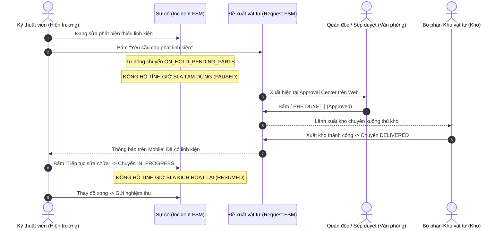

# 🌉 CẦU NỐI HIỆN TRƯỜNG ↔ VĂN PHÒNG (FIELD-TO-OFFICE SPARE PARTS BRIDGE)

> **Phân hệ:** Cầu nối liên thông nghiệp vụ (Cross-domain Integration)  
> **Áp dụng cho:** Kỹ thuật viên hiện trường, Trưởng phòng mua sắm, Quản đốc nhà máy, Thủ kho  
> **Thuộc hệ thống:** [Tài liệu đặc tả nghiệp vụ Flowse 2.0](file:///c:/Users/Vinh%20Nguyen/MOBILE/flowse-enterprise-platform/docs/)

---

## 1. BÀI TOÁN KẾT NỐI SẢN XUẤT VÀ VĂN PHÒNG

Trong thực tế vận hành nhà xưởng, khoảng **40% các sự cố máy móc không thể sửa chữa ngay** vì thiếu vật tư, linh kiện thay thế (cháy vòng bi, đứt dây curoa, hỏng cảm biến...).
* **Thực trạng yếu kém thường gặp:** Kỹ thuật viên phải chạy lên văn phòng viết phiếu giấy xin mua, chờ sếp ký duyệt, rồi xuống kho kiểm tra. Quá trình này mất từ vài giờ đến vài ngày.
* **Hậu quả:** Sự cố bị treo, nhưng hệ thống quản lý thông thường vẫn tiếp tục đếm giờ làm cho chỉ số SLA bị phạt vi phạm (Breached) một cách oan uổng. Cấp quản lý không nắm được nguyên nhân máy dừng là do kỹ thuật viên lười biếng hay do phòng mua sắm chậm trễ.

**Flowse 2.0 giải quyết dứt điểm điểm nghẽn này** bằng cách tích hợp trực tiếp luồng **Đề xuất vật tư (Purchase / Material Request)** vào trong vòng đời của Sự cố.

---

## 2. CHU TRÌNH TÁC NGHIỆP LIÊN PHÒNG BAN



---

## 3. CƠ CHẾ ĐÓNG BĂNG & TIẾP TỤC ĐỒNG HỒ SLA (SLA FREEZE & RESUME)

Đây là tính năng nghiệp vụ cao cấp phản ánh đúng thực tế công nghiệp:

### 3.1. Điểm Tạm dừng (Pause Condition):
* Khi Kỹ thuật viên thực hiện bước chuyển trạng thái sang `ON_HOLD_PENDING_PARTS`, hệ thống thực thi câu lệnh kiểm tra:
  ```sql
  UPDATE sla_instances 
  SET 
      state = 'PAUSED',
      paused_at = NOW()
  WHERE work_item_id = :incidentId AND state = 'RUNNING';
  ```
* Toàn bộ thời gian máy móc phải nằm chờ linh kiện từ nhà cung cấp hoặc thủ kho sẽ **KHÔNG ĐƯỢC TÍNH VÀO THỜI GIAN SỬA CHỮA CỦA KỸ THUẬT VIÊN**.

### 3.2. Điểm Kích hoạt lại (Resume Condition):
* Ngay khi phiếu yêu cầu vật tư liên quan chuyển sang trạng thái `DELIVERED` hoặc `COMPLETED`, hoặc khi Kỹ thuật viên chủ động bấm nút *"Tiếp tục sửa chữa"*:
  * Hệ thống tính toán thời lượng đã tạm dừng:  
    $$\Delta t_{paused} = \text{NOW}() - \text{paused\_at}$$
  * Cộng bù thời lượng này vào mốc vi phạm SLA:  
    $$\text{sla\_breach\_at}_{mới} = \text{sla\_breach\_at}_{cũ} + \Delta t_{paused}$$
  * Đưa trạng thái SLA trở lại `RUNNING`:
  ```sql
  UPDATE sla_instances 
  SET 
      state = 'RUNNING',
      resumed_at = NOW(),
      target_breach_at = target_breach_at + (NOW() - paused_at),
      paused_at = NULL
  WHERE work_item_id = :incidentId AND state = 'PAUSED';
  ```

---

## 4. QUAN HỆ DỮ LIỆU LIÊN KẾT (PARENT-CHILD SCHEMA)

Mối liên kết giữa sự cố và đề xuất vật tư được thiết lập thông qua hai trường khóa ngoại trong bảng `work_items`:

```text
┌─────────────────────────────────┐
│     WORK ITEM: INCIDENT         │
│ id: 550e8400-e29b...            │
│ code: "INC-2026-089"            │
│ status: "ON_HOLD_PENDING_PARTS" │
└────────────────┬────────────────┘
                 │ (1 - Nhiều: 1 sự cố có thể cần nhiều đề xuất)
                 ▼
┌─────────────────────────────────┐
│      WORK ITEM: REQUEST         │
│ id: 7b29a103-f38c...            │
│ code: "REQ-2026-042"            │
│ parent_id: 550e8400-e29b... <───┘ (Trỏ trực tiếp về ID của Incident)
│ type: "REQUEST"                 │
│ title: "Xin 01 Vòng bi SKF 6205"│
│ status: "SUBMITTED"             │
└─────────────────────────────────┘
```

### Lợi ích của thiết kế:
1. **Truy vết hai chiều (Bidirectional Traceability):**
   * Đứng từ màn hình Sự cố: Nhìn thấy ngay danh sách các vật tư đang chờ duyệt đi kèm mã phiếu đề xuất.
   * Đứng từ màn hình Phê duyệt (Approval Center): Nhìn thấy rõ đề xuất này phục vụ cho việc khắc phục sự cố nào, mức độ khẩn cấp ra sao.
2. **Kế thừa quyền hạn:** Người duyệt đề xuất có thể trực tiếp bấm vào xem ảnh chụp sự cố ban đầu để thẩm định xem có đúng là linh kiện đã bị hỏng hóc hay không trước khi ký duyệt xuất tiền.
