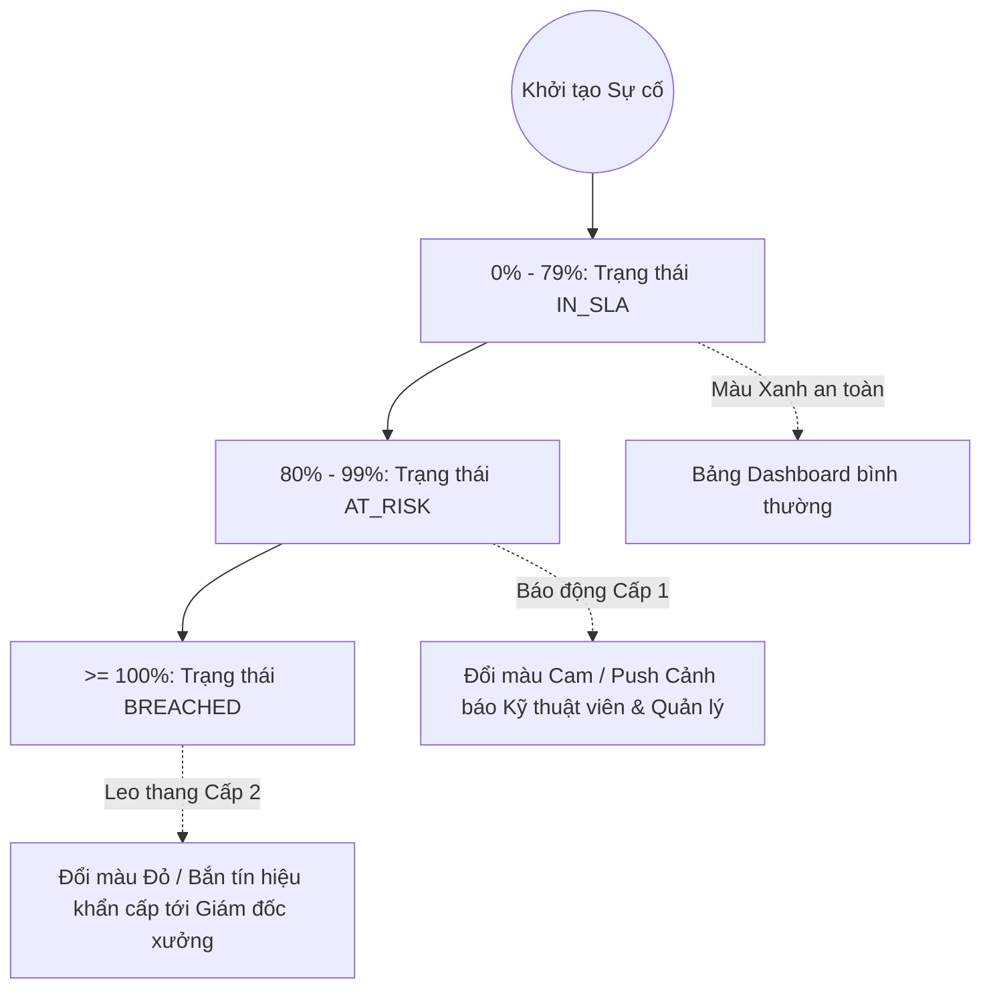

# ⏱️ CAM KẾT THỜI GIAN & LEO THANG CẢNH BÁO (SLA & ESCALATION ENGINE)

> **Phân hệ:** Quản trị hiệu năng & Cam kết chất lượng dịch vụ  
> **Áp dụng cho:** Quản lý sản xuất, Kỹ thuật viên, Trưởng ca  
> **Thuộc hệ thống:** [Tài liệu đặc tả nghiệp vụ Flowse 2.0](file:///c:/Users/Vinh%20Nguyen/MOBILE/flowse-enterprise-platform/docs/)

---

## 1. NGUYÊN TẮC QUẢN LÝ SLA TRONG DOANH NGHIỆP

**SLA (Service Level Agreement)** trong Flowse 2.0 hoàn toàn khác với một Deadline tĩnh thông thường:
* **Deadline:** Chỉ là một mốc thời gian cố định (ví dụ: ngày 15/10 phải xong).
* **SLA:** Là một thỏa ước dịch vụ động (Dynamic Service Commitment), bao gồm:
  1. **Response SLA:** Cam kết thời gian tối đa từ lúc sự việc phát sinh đến khi có người chịu trách nhiệm tiếp nhận.
  2. **Resolution SLA:** Cam kết thời gian tối đa để khắc phục và trả lại trạng thái an toàn.
  3. **Quy tắc tính toán theo giờ làm việc (Business Calendar):** Phân biệt giữa tác vụ văn phòng và sự cố nhà máy khẩn cấp.
  4. **Cơ chế leo thang cảnh báo (Automated Escalation):** Tự động phát tín hiệu cảnh báo trước khi sự cố bị trễ hạn.

---

## 2. BẢNG CẤU HÌNH THỜI GIAN SLA CHUẨN

Hệ thống thiết lập sẵn bảng quy chuẩn thời gian tính toán tự động dựa trên độ nghiêm trọng (Severity) của Sự cố:

| Mức độ nghiêm trọng | Thời gian phản hồi (Response SLA) | Thời gian khắc phục (Resolve SLA) | Ngưỡng báo động vàng (Warning Threshold - 80%) | Khung giờ áp dụng |
| :--- | :---: | :---: | :---: | :--- |
| **`CRITICAL` (P1)** | **15 phút** | **2 giờ** | Sau 1 giờ 36 phút | **24/7 (Bất kể ngày đêm/cuối tuần)** |
| **`HIGH` (P2)** | **30 phút** | **4 giờ** | Sau 3 giờ 12 phút | **24/7 (Bất kể ngày đêm/cuối tuần)** |
| **`MEDIUM` (P3)** | **2 giờ** | **12 giờ** | Sau 9 giờ 36 phút | Giờ làm việc hành chính (8h00 - 17h00) |
| **`LOW` (P4)** | **8 giờ** | **48 giờ** | Sau 38 giờ 24 phút | Giờ làm việc hành chính (8h00 - 17h00) |

---

## 3. CƠ CHẾ LEO THANG CẢNH BÁO 3 CẤP ĐỘ (3-TIER ESCALATION)

Động cơ SLA liên tục giám sát tỷ lệ thời gian tiêu tốn:  
$$\text{Tiến độ SLA} = \frac{\text{Thời gian đã trôi qua}}{\text{Tổng thời hạn cho phép}} \times 100\%$$

### Chi tiết các cấp độ leo thang:

1. **Cấp độ 1 — Bình thường (`IN_SLA`):**
   * Thời gian tiêu tốn $< 80\%$.
   * Biểu tượng trên Web/Mobile hiển thị màu xanh lá cây kèm đồng hồ đếm ngược.
2. **Cấp độ 2 — Nguy cơ cao (`AT_RISK` - Báo động vàng):**
   * Đạt ngưỡng **80%** thời hạn cho phép.
   * **Hành động tự động:**
     * Thẻ sự cố trên Web Console chuyển sang viền màu cam nhấp nháy.
     * Phát sự kiện WebSocket `SLA_AT_RISK` đến Web của Quản lý.
     * Bắn Push Notification đến điện thoại Kỹ thuật viên: *"Cảnh báo: Bạn chỉ còn 20% thời gian để hoàn tất sự cố CNC-024!"*.
3. **Cấp độ 3 — Vi phạm SLA (`BREACHED` - Báo động đỏ):**
   * Chạm mốc **100%** thời gian cho phép mà chưa nghiệm thu.
   * **Hành động tự động:**
     * Trạng thái SLA đổi sang `BREACHED`, hiển thị nhãn màu đỏ rực.
     * Gửi email hoặc thông báo khẩn cấp tới Quản đốc phân xưởng / Giám đốc sản xuất.
     * Ghi nhận 01 điểm vi phạm vào hồ sơ KPI định kỳ của tổ kỹ thuật.

---

## 4. KIẾN TRÚC SCHEDULER & WORKER CHẠY NGẦM

Để đảm bảo đồng hồ SLA chạy chính xác và không bị phụ thuộc vào việc người dùng có mở trình duyệt hay không, hệ thống sử dụng kiến trúc Worker định kỳ:

* **Cron Worker (hoặc RabbitMQ Delayed Queue):** Chạy quét ngầm mỗi **60 giây** một lần:
  1. Truy vấn các sự cố đang ở trạng thái `IN_PROGRESS` và `sla_state = 'RUNNING'`.
  2. So sánh thời gian thực hiện tại với `target_breach_at`.
  3. Nếu vượt mốc 80% mà chưa gửi cảnh báo $\rightarrow$ Thực hiện gửi cảnh báo `AT_RISK`.
  4. Nếu vượt mốc 100% mà chưa đánh dấu vi phạm $\rightarrow$ Cập nhật `sla_state = 'BREACHED'` và kích hoạt leo thang cấp 3.
