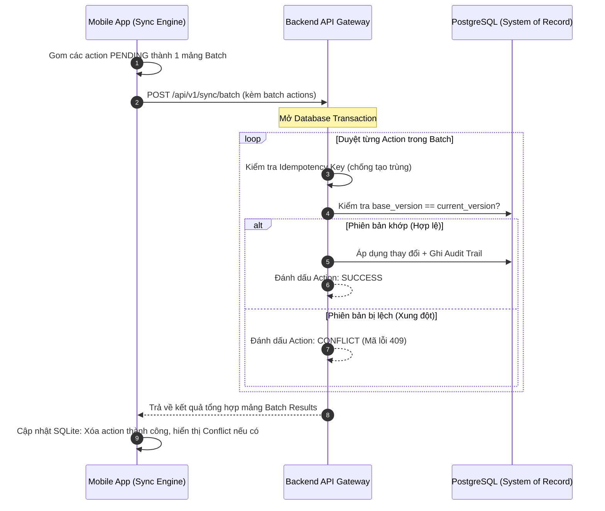

# 📴 TÁC NGHIỆP NGOẠI TUYẾN & ĐỒNG BỘ (MOBILE OFFLINE-FIRST & SYNC)

> **Phân hệ:** Hạ tầng di động ngoại tuyến (Mobile Infrastructure)  
> **Áp dụng cho:** Ứng dụng di động Flowse 2.0 (React Native / Expo)  
> **Thuộc hệ thống:** [Tài liệu đặc tả nghiệp vụ Flowse 2.0](file:///c:/Users/Vinh%20Nguyen/MOBILE/flowse-enterprise-platform/docs/)

---

## 1. NGUYÊN TẮC THIẾT KẾ OFFLINE-FIRST

Trong môi trường công nghiệp, hiện tượng mất sóng Internet (sóng Wifi/4G chập chờn trong hầm máy, khu vực bọc tôn cách âm, kho sâu) xảy ra thường xuyên.
* **Nguyên tắc cốt lõi:** Người dùng không bao giờ bị chặn đứng công việc vì mất mạng. Ứng dụng phải phản hồi ngay lập tức trên giao diện (Optimistic UI), lưu thao tác vào hàng đợi cục bộ và tự động đồng bộ khi có kết nối trở lại.
* **Ranh giới an toàn:** Offline-first **không có nghĩa là cho phép làm mọi thứ khi mất mạng**. Các hành động nhạy cảm đòi hỏi tính xác thực thời gian thực bắt buộc phải thực hiện online.

---

## 2. RANH GIỚI HÀNH VI: WHITELIST VS BLACKLIST

Hệ thống phân định nghiêm ngặt hai nhóm hành động:

```text
┌────────────────────────────────────────────────────────────────────────┐
│             DANH MỤC HÀNH ĐỘNG ĐƯỢC PHÉP OFFLINE (WHITELIST)           │
│                                                                        │
│  [✓] Xem danh sách công việc đã cache trong SQLite                     │
│  [✓] Đọc chi tiết Work Item, xem lịch sử và tài liệu đính kèm đã tải   │
│  [✓] Thực hiện tick Checklist kiểm tra định kỳ (Pass/Fail)             │
│  [✓] Nhập bình luận tiến độ (Comments / Notes)                         │
│  [✓] Tạo bản nháp sự cố mới (Draft Incident) kèm chụp ảnh evidence     │
│  [✓] Kỹ thuật viên chuyển trạng thái cá nhân: ASSIGNED -> IN_PROGRESS  │
└────────────────────────────────────────────────────────────────────────┘
                                    │
                                    │ Đối lập hoàn toàn
                                    ▼
┌────────────────────────────────────────────────────────────────────────┐
│             DANH MỤC HÀNH ĐỘNG BẮT BUỘC ONLINE (BLACKLIST)             │
│                                                                        │
│  [✗] Phê duyệt ngân sách / Đề xuất vật tư (APPROVE / REJECT)           │
│  [✗] Thay đổi phân quyền thành viên, cấp tài khoản, đổi vai trò        │
│  [✗] Tái phân công công việc cho người khác (Reassign)                 │
│  [✗] Nghiệm thu đóng dứt điểm sự cố (RESOLVED / CLOSED)                │
│  [✗] Thay đổi cấu trúc quy trình Workflow Definitions                  │
└────────────────────────────────────────────────────────────────────────┘
```

> [!CAUTION]
> Nếu người dùng cố tình thực hiện các thao tác thuộc **Blacklist** khi đang mất mạng, ứng dụng sẽ hiển thị thông báo nhẹ nhàng: *"Thao tác này yêu cầu kết nối mạng trực tuyến để xác thực an toàn. Vui lòng kết nối lại mạng để tiếp tục."*

---

## 3. CƠ CHẾ HÀNG ĐỢI NỘI BỘ (LOCAL ACTION QUEUE)

Trên thiết bị di động, cơ sở dữ liệu **SQLite** duy trì một bảng chuyên trách lưu trữ các hành động chờ gửi:

```sql
CREATE TABLE offline_actions (
    id TEXT PRIMARY KEY,                 -- UUID sinh tại client
    action_type TEXT NOT NULL,           -- 'TRANSITION' | 'ADD_COMMENT' | 'CREATE_DRAFT' | 'TICK_CHECKLIST'
    entity_type TEXT NOT NULL,           -- 'WORK_ITEM' | 'INSPECTION'
    entity_id TEXT NOT NULL,             -- ID của bản ghi liên quan
    payload TEXT NOT NULL,               -- Chuỗi JSON chứa dữ liệu gửi lên
    base_version INTEGER NOT NULL,       -- Phiên bản của bản ghi lúc client đọc được
    idempotency_key TEXT UNIQUE NOT NULL,-- Khóa chống lặp dữ liệu (UUID)
    created_at TEXT NOT NULL,            -- Mốc thời gian tạo thao tác ngoại tuyến
    status TEXT DEFAULT 'PENDING',       -- 'PENDING' | 'SYNCING' | 'FAILED' | 'CONFLICT'
    retry_count INTEGER DEFAULT 0,
    last_error TEXT
);
```

---

## 4. GIAO THỨC ĐỒNG BỘ THEO LÔ (BATCH SYNC API)

Khi thiết bị phát hiện kết nối mạng được khôi phục (`NetInfo.isConnected === true`):



---

## 5. XỬ LÝ XUNG ĐỘT PHIÊN BẢN (VERSION CONFLICT RESOLUTION)

Hệ thống Flowse 2.0 áp dụng cơ chế **Khóa lạc quan (Optimistic Locking)**. Tuyệt đối **KHÔNG dùng "Last Write Wins"** vì sẽ làm mất dữ liệu của người khác một cách âm thầm.

### Kịch bản xảy ra xung đột (Conflict Scenario):
1. Lúc 10:00, Kỹ thuật viên A tải thông tin Sự cố CNC-024 về điện thoại (Lúc này máy chủ đang ở `version = 3`).
2. Lúc 10:05, Kỹ thuật viên A bị mất mạng trong xưởng, bấm sửa ghi chú cục bộ (`base_version = 3`).
3. Lúc 10:08, Quản lý B ngồi văn phòng mở Web và cập nhật lại mức độ ưu tiên sự cố lên `HIGH` (Máy chủ tăng lên `version = 4`).
4. Lúc 10:15, Kỹ thuật viên A có mạng lại, Mobile gửi gói đồng bộ với `base_version = 3`.
5. **Máy chủ phát hiện:** `base_version (3) < current_version (4)` $\rightarrow$ Từ chối ghi đè, trả về mã lỗi **`HTTP 409 Conflict`**.

### Giao diện giải quyết xung đột trên Mobile:
Trên màn hình điện thoại của Kỹ thuật viên A sẽ xuất hiện hộp thoại đối chiếu:
* **Thông báo:** *"Dữ liệu sự cố này đã được Quản lý cập nhật trên hệ thống trong lúc bạn mất mạng."*
* **3 Lựa chọn cho người dùng:**
  1. **Nạp dữ liệu mới nhất từ máy chủ (Discard my draft):** Bỏ bản nháp offline, lấy bản chuẩn từ server.
  2. **Ghi đè bằng dữ liệu của tôi (Force Overwrite):** Áp dụng thay đổi của tôi lên server (yêu cầu xác nhận lần 2).
  3. **Lưu thành bình luận bổ sung (Append as Comment):** Giữ nguyên trạng thái server và chèn nội dung offline thành một bình luận mới để không mất thông tin.
