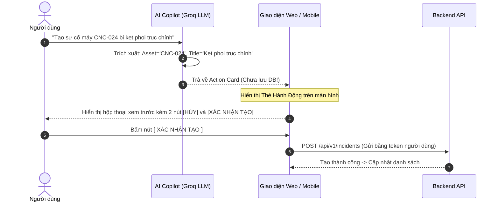

# 🤖 TRỢ LÝ TRÍ TUỆ NHÂN TẠO & NGUYÊN TẮC AN TOÀN (AI WORK COPILOT)

> **Phân hệ:** Trí tuệ nhân tạo hỗ trợ công việc (AI Assistance)  
> **Áp dụng cho:** Web Console & Mobile App  
> **Thuộc hệ thống:** [Tài liệu đặc tả nghiệp vụ Flowse 2.0](file:///c:/Users/Vinh%20Nguyen/MOBILE/flowse-enterprise-platform/docs/)

---

## 1. NGUYÊN TẮC: AI LÀ COPILOT, KHÔNG PHẢI AUTHORITY

Trong môi trường doanh nghiệp và sản xuất, sai số của AI (Hallucination) có thể dẫn đến hậu quả nghiêm trọng (dừng máy sai lịch, duyệt chi phí sai, xóa dữ liệu).
* **Triết lý sản phẩm:** AI trong Flowse 2.0 đóng vai trò là **Trợ lý đồng hành (Copilot)** hỗ trợ con người giảm tải các thao tác nhập liệu, tìm kiếm thông tin và tổng hợp báo cáo.
* **Quy tắc bất khả xâm phạm:**
  1. AI **tuyệt đối không được cấp quyền ghi trực tiếp vào cơ sở dữ liệu** (Không cấp DB write connection cho LLM).
  2. AI **không được tự động ra quyết định phê duyệt** (`APPROVE` / `REJECT`).
  3. AI **không được tự động đóng hoặc xóa sự cố**.
  4. Mọi tác vụ có khả năng làm thay đổi trạng thái hệ thống bắt buộc phải thông qua **Cơ chế xác nhận của con người (Human-in-the-loop via Action Cards)**.

---

## 2. KIẾN TRÚC GỌI HÀM CỦA AI (TOOL ROUTER & TOOL CALLING)

Hệ thống tích hợp mô hình ngôn ngữ lớn **Llama 3.3 70B** thông qua Groq SDK. Thay vì để LLM tự do sinh mã, hệ thống thiết lập sẵn 4 công cụ (Deterministic Tools) chuẩn:

```text
       Người dùng nhập câu lệnh tự nhiên (Prompt)
                           │
                           ▼
                  [ AI WORK COPILOT ]
                           │
       Phân tích ý định & Lựa chọn công cụ phù hợp
                           │
         ┌─────────────────┼─────────────────┐
         ▼                 ▼                 ▼
 ┌───────────────┐ ┌───────────────┐ ┌───────────────┐
 │ query_work_items│ draft_incident│summarize_thread │
 └───────────────┘ └───────────────┘ └───────────────┘
         │                 │                 │
     Đọc dữ liệu        Tạo JSON         Đọc bình luận
  (Có kiểm tra quyền)  Thẻ hành động   và tóm tắt 3 dòng
```

### Danh mục 4 công cụ chính thức:

| Tên công cụ (Tool Name) | Đầu vào (Arguments) | Mục đích nghiệp vụ | Kết quả trả về |
| :--- | :--- | :--- | :--- |
| **`query_work_items`** | `{ "status": "OVERDUE", "priority": "HIGH" }` | Tra cứu danh sách công việc theo điều kiện lọc tự nhiên. | Danh sách Work Item trong phạm vi quyền hạn của người hỏi. |
| **`draft_incident`** | `{ "asset_code": "CNC-024", "symptom": "..." }` | Trích xuất thông tin từ đoạn văn bản/giọng nói để tạo mẫu sự cố nháp. | Gói dữ liệu `Draft Incident Card` chờ người dùng xác nhận. |
| **`summarize_thread`** | `{ "work_item_id": "uuid" }` | Tóm tắt nhanh chuỗi 20-30 bình luận trao đổi kỹ thuật phức tạp. | 3 gạch đầu dòng súc tích: Nguyên nhân, Hiện trạng, Bước tiếp theo. |
| **`suggest_triage`** | `{ "description": "..." }` | Gợi ý mức độ nghiêm trọng (P1-P4) và kỹ thuật viên chuyên trách. | Gợi ý tham khảo kèm độ tin cậy (`confidence_score`). |

---

## 3. GIAO THỨC THẺ HÀNH ĐỘNG (ACTION CARD PROTOCOL)

Khi người dùng ra lệnh cho AI thực hiện một hành động (Ví dụ: *"Hãy tạo sự cố máy CNC-024 bị kẹt phoi"*):



### Minh họa Action Card trên giao diện:
```text
┌─────────────────────────────────────────────────────────┐
│ 🤖 TRỢ LÝ AI ĐÃ SOẠN BẢN NHÁP SỰ CỐ                     │
├─────────────────────────────────────────────────────────┤
│ • Thiết bị: Máy phay CNC-024 (Khu A)                    │
│ • Tiêu đề: Kẹt phoi trục chính                          │
│ • Độ ưu tiên đề xuất: HIGH (P2)                         │
│ • Phân loại: Sự cố cơ khí                               │
├─────────────────────────────────────────────────────────┤
│ [ ✏️ Chỉnh sửa chi tiết ]   [ ❌ Hủy bỏ ]   [  XÁC NHẬN TẠO ] │
└─────────────────────────────────────────────────────────┘
```

---

## 4. TÍNH BẢO VỆ ĐỘC LẬP CỦA HỆ THỐNG (FAULT TOLERANCE)

* Nếu kết nối Internet chập chờn, quota Groq SDK bị hết hoặc dịch vụ AI gặp sự cố:
  * **Hệ thống lõi (Core Business Engine) vẫn tiếp tục hoạt động 100% bình thường.**
  * Các chức năng tạo việc thủ công, quét mã QR, chuyển trạng thái FSM, kiểm tra checklist, duyệt đề xuất đều không bị ảnh hưởng.
  * Ứng dụng chỉ hiển thị thông báo: *"Trợ lý AI tạm thời không khả dụng, vui lòng thao tác trực tiếp."*
