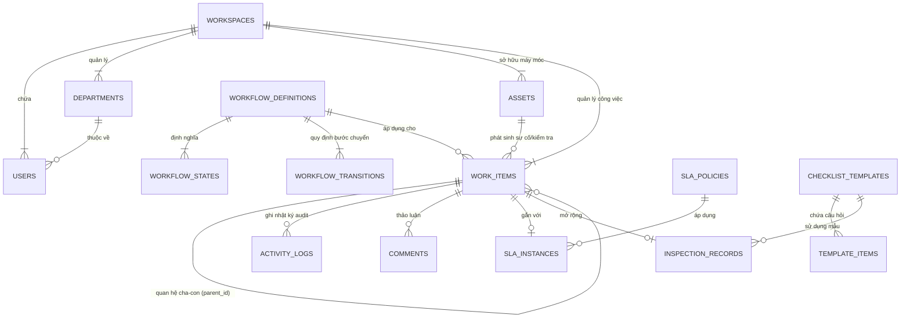

# 🗄️ THIẾT KẾ CƠ SỞ DỮ LIỆU & SƠ ĐỒ THỰC THỂ (DATABASE ERD MAPPING)

> **Phân hệ:** Hạ tầng lưu trữ dữ liệu chính thức (System of Record)  
> **Hệ quản trị:** PostgreSQL 16  
> **Thuộc hệ thống:** [Tài liệu đặc tả nghiệp vụ Flowse 2.0](file:///c:/Users/Vinh%20Nguyen/MOBILE/flowse-enterprise-platform/docs/)

---

## 1. SƠ ĐỒ THỰC THỂ TỔNG QUAN (CONCEPTUAL ERD)

---

## 2. DANH MỤC CÁC BẢNG CỐT LÕI (CORE TABLES SPECIFICATION)

### 2.1. Bảng `work_items` (Bảng trung tâm của toàn hệ thống)
Chứa mọi công việc, sự cố, đề xuất và phiếu kiểm tra:

| Tên cột | Kiểu dữ liệu | Ràng buộc | Mục đích nghiệp vụ |
| :--- | :--- | :--- | :--- |
| `id` | `UUID` | `PRIMARY KEY` | Khóa chính duy nhất. |
| `code` | `VARCHAR(50)` | `UNIQUE, NOT NULL` | Mã hiển thị thân thiện (vd: `TSK-001`, `INC-102`). |
| `type` | `VARCHAR(30)` | `NOT NULL` | Phân loại: `TASK`, `INCIDENT`, `REQUEST`, `APPROVAL`, `INSPECTION`. |
| `title` | `VARCHAR(255)` | `NOT NULL` | Tiêu đề ngắn gọn của đầu việc. |
| `description`| `TEXT` | | Mô tả chi tiết vấn đề. |
| `status` | `VARCHAR(50)` | `NOT NULL` | Trạng thái hiện tại trong State Machine. |
| `priority` | `VARCHAR(20)` | `DEFAULT 'MEDIUM'` | `CRITICAL`, `HIGH`, `MEDIUM`, `LOW`. |
| `parent_id` | `UUID` | `FK -> work_items(id)` | Khóa ngoại hỗ trợ liên kết cha-con (vd: Request gắn với Incident). |
| `creator_id`| `UUID` | `FK -> users(id)` | Người khởi tạo bản ghi. |
| `assignee_id`| `UUID` | `FK -> users(id)` | Người chịu trách nhiệm xử lý chính. |
| `workflow_id`| `UUID` | `FK -> workflow_definitions(id)` | Quy trình FSM điều phối vòng đời của item này. |
| `asset_id` | `UUID` | `FK -> assets(id)` | Máy móc liên quan (đối với Incident hoặc Inspection). |
| `version` | `INTEGER` | `NOT NULL, DEFAULT 1`| **Khóa lạc quan (Optimistic Locking) chống ghi đè khi đồng bộ ngoại tuyến**. |
| `created_at`| `TIMESTAMPTZ`| `DEFAULT NOW()` | Thời điểm tạo bản ghi. |
| `updated_at`| `TIMESTAMPTZ`| `DEFAULT NOW()` | Thời điểm cập nhật gần nhất. |

---

### 2.2. Bảng `workflow_definitions`, `workflow_states` & `workflow_transitions`
Kiểm soát toàn bộ máy trạng thái (FSM):

* **`workflow_definitions`:** `id`, `name`, `code`, `applicable_type` ('INCIDENT', 'TASK', 'REQUEST'), `is_active`.
* **`workflow_states`:** `id`, `workflow_id`, `state_code` ('REPORTED', 'IN_PROGRESS'...), `name`, `is_initial`, `is_terminal`.
* **`workflow_transitions`:** `id`, `workflow_id`, `from_state_id`, `to_state_id`, `action_name`, `allowed_roles` (mảng các vai trò được phép bấm), `required_fields` (danh sách trường bắt buộc có dữ liệu).

---

### 2.3. Bảng `assets` (Quản lý thiết bị & QR Context)

| Tên cột | Kiểu dữ liệu | Ràng buộc | Mục đích nghiệp vụ |
| :--- | :--- | :--- | :--- |
| `id` | `UUID` | `PRIMARY KEY` | Khóa chính. |
| `code` | `VARCHAR(50)` | `UNIQUE, NOT NULL` | Mã định danh thiết bị hiển thị (vd: `CNC-024`). |
| `name` | `VARCHAR(255)`| `NOT NULL` | Tên thiết bị (vd: *Máy phay CNC 5 trục Haas VF-2*). |
| `location` | `VARCHAR(255)`| | Vị trí đặt máy (vd: *Phân xưởng Cơ khí A - Trạm 2*). |
| `qr_token` | `VARCHAR(100)`| `UNIQUE, NOT NULL` | **Opaque Token bảo mật in trên tem mã QR**. |
| `status` | `VARCHAR(30)` | `DEFAULT 'OPERATIONAL'`| 'OPERATIONAL', 'WARNING', 'DOWN', 'MAINTENANCE'. |
| `department_id`| `UUID` | `FK -> departments(id)`| Thuộc phân xưởng nào (Phạm vi Resource Scope). |

---

### 2.4. Bảng `sla_instances` (Theo dõi tiến độ thời gian thực)

| Tên cột | Kiểu dữ liệu | Ràng buộc | Mục đích nghiệp vụ |
| :--- | :--- | :--- | :--- |
| `id` | `UUID` | `PRIMARY KEY` | Khóa chính. |
| `work_item_id` | `UUID` | `FK -> work_items(id)` | Gắn với sự cố hoặc công việc nào. |
| `state` | `VARCHAR(30)` | `DEFAULT 'RUNNING'` | `RUNNING`, `PAUSED`, `MET`, `BREACHED`. |
| `target_breach_at`| `TIMESTAMPTZ`| `NOT NULL` | Mốc thời gian sẽ bị vi phạm nếu chưa xong. |
| `warning_at` | `TIMESTAMPTZ`| `NOT NULL` | Mốc chạm ngưỡng 80% để bắn cảnh báo vàng (`AT_RISK`). |
| `paused_at` | `TIMESTAMPTZ`| | Mốc thời gian tạm dừng (khi chuyển sang On-Hold chờ vật tư). |
| `total_paused_seconds`| `INTEGER` | `DEFAULT 0` | Tổng số giây đã được cộng bù do phải chờ vật tư. |

---

### 2.5. Bảng `activity_logs` (Nhật ký kiểm toán Audit Trail)
Ghi nhận toàn bộ vết lịch sử vận hành, không cho phép xóa:

| Tên cột | Kiểu dữ liệu | Mục đích nghiệp vụ |
| :--- | :--- | :--- |
| `id` | `UUID PRIMARY KEY` | Khóa chính. |
| `work_item_id` | `UUID` | Gắn với công việc nào. |
| `actor_id` | `UUID` | Ai là người thực hiện (User ID). |
| `action` | `VARCHAR(50)` | Tên hành động: `TRANSITION`, `ASSIGN`, `APPROVE`, `SYNC_CONFLICT`... |
| `from_status` | `VARCHAR(50)` | Trạng thái trước khi chuyển. |
| `to_status` | `VARCHAR(50)` | Trạng thái sau khi chuyển. |
| `payload` | `JSONB` | Dữ liệu chi tiết đi kèm (ghi chú, ảnh, lý do từ chối...). |
| `created_at` | `TIMESTAMPTZ` | Thời điểm chính xác xảy ra hành động. |
