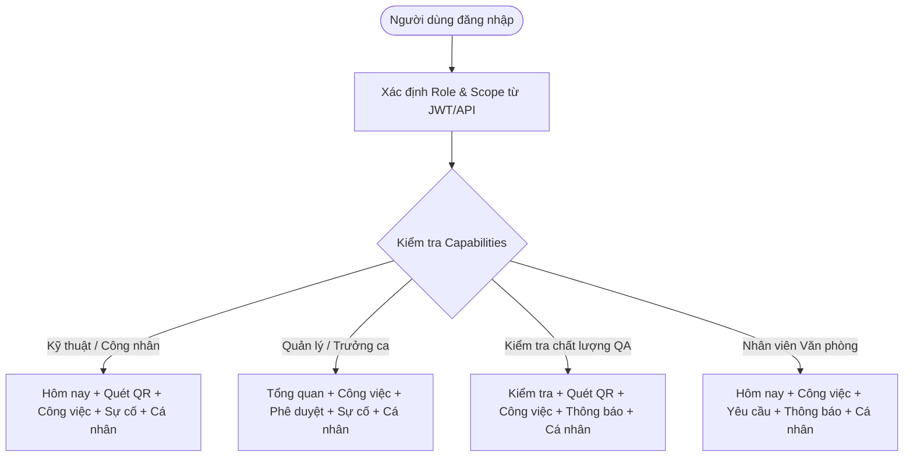

# 📱 FLOWSE 2.0 — MOBILE SPECIFICATION (REFACTORED & STREAMLINED V1.0)

> **Tài liệu đặc tả chuẩn hóa Mobile App React Native cho Flowse 2.0 Enterprise Platform.**  
> *Đã lọc bỏ toàn bộ các điểm dư thừa, xung đột và suy đoán ngoài phạm vi từ bản dự thảo `FLOWSE_SRS_Mobile_v1.docx`.*

---

## 1. NGUYÊN TẮC THIẾT KẾ & ĐỊNH HƯỚNG SẢN PHẨM

### 1.1. Triết lý vận hành cốt lõi
> **"Web để quản trị và điều phối. Mobile để thực thi công việc. Workflow để điều phối nghiệp vụ."**

* **Khối Hiện trường (Field Operations):** Công nhân, kỹ thuật viên, giám sát viên sử dụng **Mobile App** tối ưu cho thao tác một tay (One-thumb friendly): Quét QR thiết bị, báo sự cố kèm ảnh chụp, chạy checklist kiểm tra máy móc, nhận thông báo đẩy tức thời, và thực hiện công việc ngoại tuyến an toàn.
* **Khối Văn phòng (Office & Management):** Nhân viên xử lý task dự án, tạo đề xuất nội bộ; Quản lý/Trưởng ca phê duyệt và điều phối công việc mọi lúc mọi nơi ngay trên thiết bị cầm tay.

### 1.2. Giải quyết triệt để các điểm dư thừa từ bản dự thảo cũ

| Vấn đề ở bản dự thảo cũ | Giải pháp chuẩn hóa (Refactored) |
| :--- | :--- |
| **Phân mảnh 12 personas** (VP, TP, CN, TC, QLDC, QLPX, QLN, KT, QC, KHO, MH, QT) dẫn đến trùng lặp màn hình và navigation cồng kềnh. | **Chuẩn hóa thành 4 nhóm vai trò (Role Archetypes)** kết hợp **Capability-driven UI** (Bottom Tab & Quick Action tự động thích ứng với quyền và phân xưởng của user). |
| **Phình to 38 màn hình vi mô** (tách riêng từng loại task detail, incident detail, maintenance detail, request detail...). | **Hợp nhất thành mô hình Universal Work Item Detail:** Một màn hình chi tiết công việc linh hoạt dùng chung, tự động render theo `work_item_type` và thanh chuyển trạng thái `WorkflowTransitionBar`. |
| **Mâu thuẫn công nghệ (Open Issue OI-01)**: Đề cập Spring Boot vs Next.js. | **Chốt cứng theo kiến trúc dự án:** Backend là **Node.js 20+ / Express 5 + PostgreSQL 16**, Mobile là **React Native + TypeScript**. Tuyệt đối không dùng Spring Boot. |
| **Lan man sang ERP / WMS / Purchasing / Chat video**: Ngoài phạm vi. | **Cắt gọt triệt để:** Không làm quản lý kho kế toán, PO hay chat video. Chỉ tập trung khép kín vòng lặp: **Sự cố ↔ Đề xuất vật tư liên kết ↔ Duyệt ↔ Cấp phát ↔ Sửa chữa xong**. |

---

## 2. KIẾN TRÚC VAI TRÒ & ĐIỀU HƯỚNG ROLE-ADAPTIVE

Thay vì tạo ứng dụng riêng cho từng chức danh, Flowse Mobile sử dụng **1 ứng dụng duy nhất** với thanh điều hướng (Bottom Tabs) tự thích ứng dựa trên **Capabilities**:



### 4 Nhóm Vai Trò Chính (Archetypes)
1. **Field Operator / Worker / Technician (`FIELD_WORKER`):** Ưu tiên Quét mã QR, Báo sự cố tức thì (1 chạm), Nhận việc sửa chữa, Tick checklist, Xin linh kiện.
2. **Supervisor / Manager (`MANAGER`):** Ưu tiên Triage sự cố, Phân công kỹ thuật viên, Phê duyệt đề xuất (Approval Inbox), Theo dõi SLA vi phạm.
3. **Quality Assurance (`QA_QC`):** Thực hiện checklist kiểm tra thiết bị định kỳ, Nghiệm thu kết quả sửa chữa trước khi đóng sự cố.
4. **Office Member (`OFFICE_MEMBER`):** Quản lý Task dự án cá nhân (My Work), Gửi phiếu yêu cầu (Internal Request), Bàn giao kết quả.

---

## 3. DANH MỤC 4 WORKFLOW CHUẨN CỦA MOBILE (P0 - MVP)

Hệ thống điều khiển chặt chẽ qua **State Machine Engine**, đảm bảo không chuyển trạng thái tùy tiện:

### 3.1. WF-01: Quy trình Xử lý Sự cố Hiện trường (Incident Management)
```text
[REPORTED] --(Triage: Supervisor)--> [TRIAGED] 
           --(Assign: Technician)--> [ASSIGNED] 
           --(Accept/Start)--------> [IN_PROGRESS] 
           --(Yêu cầu vật tư)------> [WAITING_MATERIAL] (Pause SLA)
           --(Đã nhận vật tư)------> [IN_PROGRESS] (Resume SLA)
           --(Hoàn thành sửa)------> [WAITING_VERIFY] 
           --(QA xác nhận Pass)----> [RESOLVED]
```
* **Guard Rules:**
  - Không thể nhảy cóc từ `REPORTED` sang `RESOLVED`.
  - Kỹ thuật viên không tự duyệt đóng sự cố; bắt buộc QA hoặc Quản lý nghiệm thu.
  - Chuyển `WAITING_VERIFY` bắt buộc phải upload ảnh bằng chứng kết quả (Evidence).

### 3.2. WF-02: Quy trình Kiểm tra Định kỳ (Inspection & Checklist)
```text
[ASSIGNED] --> [IN_PROGRESS] 
           --> Submit all Pass -> [PASSED]
           --> Submit any Fail -> [FAILED] (Tự động sinh Incident liên kết)
```

### 3.3. WF-03: Trung tâm Phê duyệt & Đề xuất (Approval & Internal Request)
```text
[DRAFT] --> [PENDING_APPROVAL] 
        --> [APPROVED] (Chuyển tiếp tác vụ thực hiện)
        --> [REJECTED] (Kết thúc kèm lý do)
```

### 3.4. WF-04: Quản lý Công việc Văn phòng (Universal Task Flow)
```text
[TODO] --> [IN_PROGRESS] --> [REVIEW] --> [DONE]
```

---

## 4. DANH MỤC MÀN HÌNH CHUẨN HÓA (7 CLEAN SCREEN STACKS)

Đã gom cụm 38 màn hình phân mảnh thành **7 cụm màn hình tinh gọn**:

```text
mobile/src/presentation/screens/
├── auth/
│   ├── LoginScreen.tsx                   # AUTH-01: Đăng nhập Dual-Token (JWT + Refresh)
│   └── ContextSelectScreen.tsx           # CTX-01: Chọn Nhà máy / Tổ đội làm việc
│
├── home/
│   └── HomeScreen.tsx                    # HOME-01: Dashboard thích ứng theo vai trò (KPI, SLA, Quick Actions)
│
├── workitems/
│   ├── WorkItemsListScreen.tsx           # WORK-01: Danh sách công việc (My Work, Đội nhóm, Lọc theo loại)
│   ├── WorkItemDetailScreen.tsx          # WORK-02: Chi tiết công việc (State Machine, Subtasks, Comments, Timeline)
│   └── CreateWorkItemScreen.tsx          # WORK-03: Tạo mới Task / Request / Incident thủ công
│
├── scanner/
│   └── QRScannerScreen.tsx               # QR-01: Quét mã QR camera giải mã Digital Context
│
├── assets/
│   └── AssetDetailScreen.tsx             # AST-01: Thông tin máy, sự cố đang mở, lịch sử kiểm tra
│
├── field/
│   ├── ReportIncidentScreen.tsx          # INC-01: Báo sự cố nhanh 1 tay, đính kèm ảnh bằng chứng
│   ├── InspectionRunnerScreen.tsx        # QC-01: Thực hiện checklist kiểm tra Pass/Fail
│   └── RequestMaterialModal.tsx          # MAT-01: Modal đề xuất linh kiện sửa chữa
│
├── approvals/
│   ├── ApprovalInboxScreen.tsx           # APR-01: Hộp thư xét duyệt chờ cấp quản lý xử lý
│   └── ApprovalDetailScreen.tsx          # APR-02: Xem chi tiết tờ trình và nút Approve / Reject
│
└── profile/
    └── ProfileScreen.tsx                 # PROFILE-01: Tài khoản, Đổi ngôn ngữ, Trạng thái Offline Sync
```

---

## 5. RANH GIỚI OFFLINE-FIRST (OFFLINE BOUNDARY)

| Thao tác | Chế độ Offline | Hành vi hệ thống khi có mạng trở lại |
| :--- | :---: | :--- |
| **Xem danh sách đã cache** | ✅ Cho phép | Đọc từ SQLite cục bộ, hiển thị nhãn "Dữ liệu ngoại tuyến" |
| **Báo sự cố nháp + Lưu ảnh** | ✅ Cho phép | Lưu vào `offline_actions_queue` với trạng thái `PENDING_SYNC` |
| **Tick checklist kiểm tra** | ✅ Cho phép | Lưu tạm kết quả vào SQLite, tự động sync lô khi online |
| **Bình luận / Ghi chú** | ✅ Cho phép | Lưu hàng đợi offline, đẩy lên theo thứ tự thời gian |
| **Phê duyệt / Từ chối (Approval)** | ❌ Bắt buộc Online | Hành động nhạy cảm, chặn thao tác offline |
| **Phân quyền / Đóng sự cố** | ❌ Bắt buộc Online | Tránh xung đột trạng thái nghiêm trọng |
| **Chống xung đột (Conflict)** | Cơ chế Version | Kiểm tra `base_version` so với Server, hiển thị Conflict Modal nếu version server đã tăng |
